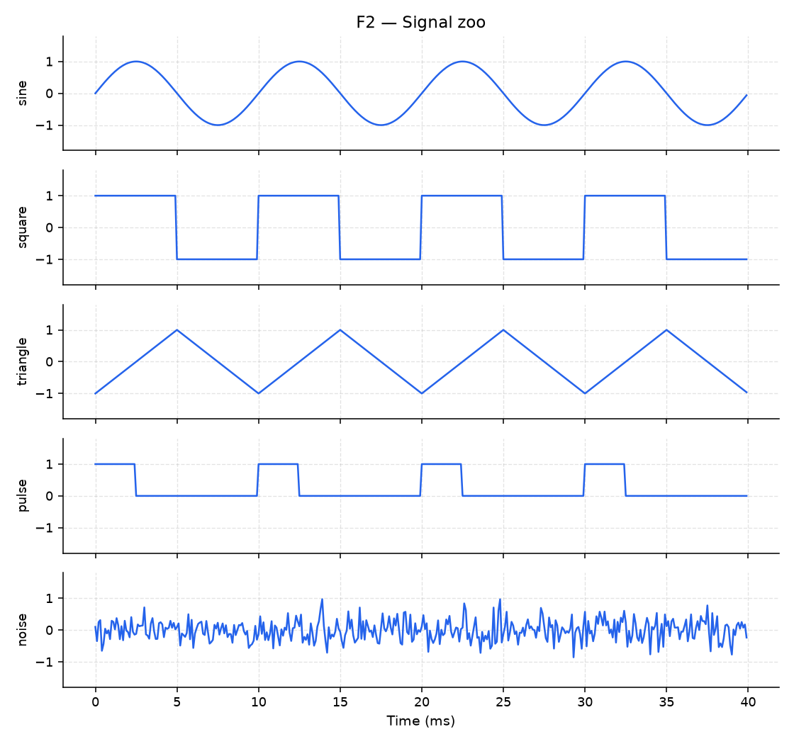

# A family of waveforms

Not every signal looks like a sine. A flute, a snare drum and radio static all make sound, but they don't share a waveform, and neither do the signals inside a chip.

## Four more shapes to know by sight

| Shape | Where you'll meet it | What it looks like |
|-------|------------------------|----------------------|
| Square | Digital clocks | Snaps between two levels, with nothing in between |
| Triangle | ADC ramps, test signals | Straight-line rise, straight-line fall |
| Pulse | Digital clocks with a tunable on-time (the **duty cycle**) | A square that spends more time low than high, or the other way round |
| Noise | Sensor readouts, the thermal noise floor | Never repeats, so it has no period at all |

The F2 explorer drives every shape from the same amplitude setting, and they still look completely different. That's the limit of judging a trace by how tall it is: two waveforms can have the same height on a datasheet and carry completely different information.

All of these shapes can be built from the same time array `t` you met on [What is a signal?](../guide/what-is-a-signal.md). The trick is a phase that counts from 0 to 1 once per cycle: compare it to a threshold and you get a square or a pulse, and ramp it up and down and you get a triangle. You'll build the whole set this way in [Lab 01](../labs/lab-01-signal-explorer-overview.md), Part 4, and the duty cycle comes back in [Rhythm and duty cycle](../guide/rhythm-and-duty-cycle.md).

## Why an engineer cares

- Clocks are squares.
- ADC ramps are triangles.
- The noise trace is the **thermal noise floor**: the smallest signal a chip can resolve above its own randomness.

Next: [Two voices in time](../guide/two-voices-in-time.md)
