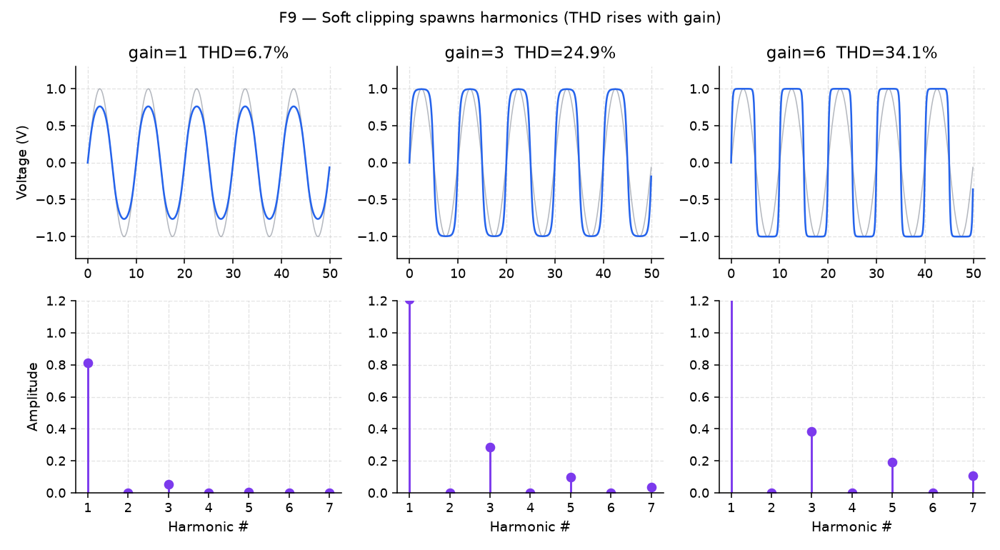

# Distortion and THD

Turn a guitar amp's gain up past the clean setting and the sound gets crunchy, with harsh new overtones that were never in the original note. The input's frequency hasn't changed; the circuit has clipped the wave, and the clipping created the new frequencies. That's **distortion**, and only a nonlinear system can produce it, because a truly linear circuit can only rescale and delay a sine and can never add new tones to it.

## New frequencies from one

Push a clean sine through a soft nonlinearity such as $\tanh$ (a smooth version of clipping), and harmonics that weren't in the input appear in the spectrum. The harder you drive it, the more it clips, and the bigger those harmonics get.

**Total harmonic distortion (THD)** sums up how much energy has moved into those extra harmonics, relative to the fundamental. $A_1$ is the amplitude of the fundamental and $A_2, A_3, \ldots$ are the amplitudes of the harmonics:

$$
\mathrm{THD} = \frac{\sqrt{A_2^2 + A_3^2 + \cdots}}{A_1}
$$

THD turns the question "how distorted does it sound?" into a single number you can read off, so you don't need a listening test to answer it. In [Lab 03](../labs/lab-03-spectrum-detective-overview.md), Part 3, you'll raise the gain on the F9 explorer and watch THD climb, and then clip a sine in your own script and measure its THD.

## Why an engineer cares

Every amplifier datasheet quotes a linearity or THD number, so this is a figure you'll keep meeting. AD103 comes back to distortion with MOSFET curves and AD201 with amplifiers, and both treat it more precisely than this page does.

Next: [Sampling fast enough](../guide/sampling-fast-enough.md)
