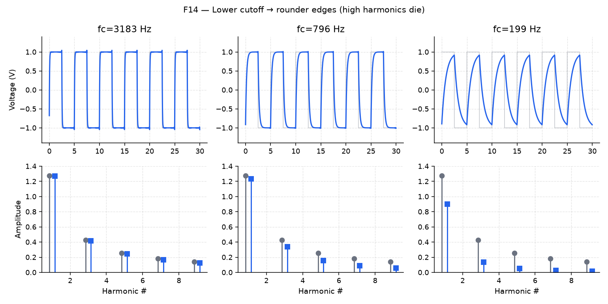

# Filtering a beat

A kick drum heard through a wall sounds muffled. You still hear the thump, but the sharp attack is gone, smoothed into something rounder and softer. What you're hearing is a low-pass filter acting on a real signal with lots of harmonics, rather than on a lone sine. The clearest circuit example of the same effect is a square wave, so that's where we start.

## A square wave through the filter

You saw in Movement II that a square wave is a pile of odd harmonics. The high harmonics are the ones that make the sharp edges, so when a low-pass filter turns them down, the edges round off. If you lower the cutoff further, the square turns into a soft, rounded blob, which is the electrical version of the muffled kick drum.

The knob that does this is the same one as on [Filters are tone knobs](../guide/filters-are-tone-knobs.md): raise $C$ and $f_c$ drops, so the edges soften more with each step, and the high odd harmonics are the first to shrink.

In [Lab 04](../labs/lab-04-rc-bode-overview.md), Part 3, you'll raise C on the F14 explorer and compare the harmonics going in with the ones coming out, and then filter a square wave in your own script.

## Parasitic RC

Every node on a chip has some **parasitic** resistance and capacitance, that is, R and C that nobody drew on the schematic. That makes every node one of these low-pass filters, whether you designed one in or not, and it's why clock speeds have a ceiling. It's also a preview of the parasitic-extraction work you'll do in AD104.

Next: [More filter shapes](../guide/more-filter-shapes.md)
