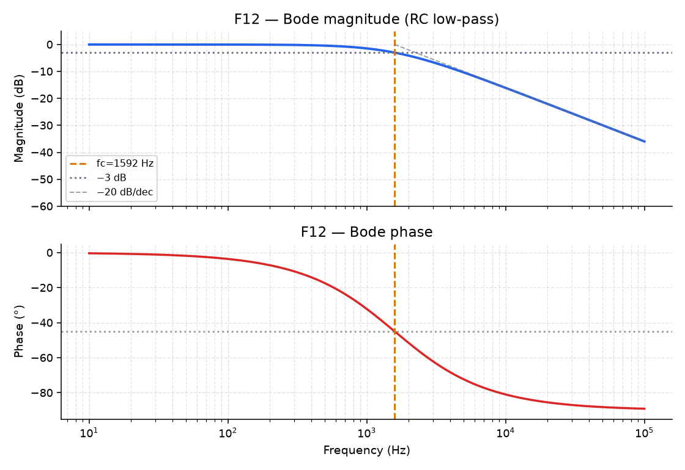

# Filters are tone knobs

The bass and treble knobs on a car stereo don't add new notes. They turn some frequencies up and others down. A **filter** does the same thing: it takes a signal's recipe and turns each entry up or down (and delays it a little). The report card for a filter is the **Bode plot**, the most-used graph in analog design.

## A circuit as a frequency machine

A Bode plot shows two things against frequency:

- **Magnitude**: how much comes out, $\lvert H(f)\rvert$, usually in dB
- **Phase**: how late it arrives, $\angle H(f)$, in degrees

## The RC low-pass

A resistor $R$ and a capacitor $C$ in the classic low-pass arrangement pass slow signals and turn down fast ones, like a treble-cut knob. It's the first filter everyone builds. Its cutoff frequency is

$$
f_c = \frac{1}{2\pi R C}
$$

Its magnitude and phase need no calculus; they're what you'd measure by sweeping the filter one frequency at a time:

$$
\lvert H(f)\rvert = \frac{1}{\sqrt{1 + (f/f_c)^2}}
\qquad
\angle H(f) = -\arctan(f/f_c)
$$

At $f = f_c$: $\lvert H\rvert = 1/\sqrt{2}$ (−3 dB) and the phase is −45°. With $R = 1\,\mathrm{k}\Omega$ and $C = 100\,\mathrm{nF}$, for example, $f_c \approx 1592$ Hz.

Only the product $RC$ matters. Double $R$ and halve $C$ and $f_c$ stays where it is, like two different amp settings that happen to land on the same tone.

You'll move R and C on the F12 explorer, then draw this Bode plot from the two formulas in your own script, in [Lab 04](../labs/lab-04-rc-bode-overview.md), Part 1.

Next: [Reading a Bode plot](../guide/reading-a-bode-plot.md)
