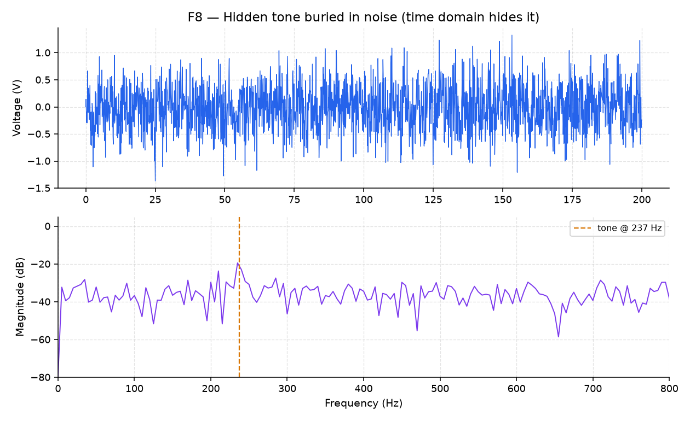
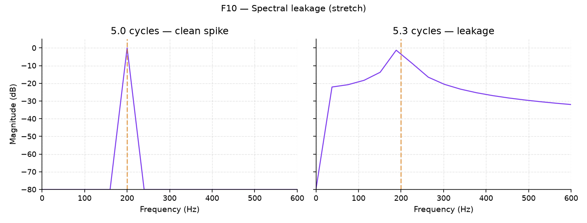

# Finding a quiet note

Stand in a loud room and try to pick out one person humming a note under the noise. Your ear struggles. A spectrum analyzer for sound wouldn't: the hum would show up as a single sharp spike sitting above the noise floor. This example is the main reason the course teaches the frequency domain.

## A tone buried in noise

A small sine under loud noise is invisible on a scope trace and obvious as a spike on a spectrum.

Tracking down coupling, 60 Hz hum, or a clock leaking into a sensitive node uses exactly this skill: stop staring at the time trace and look at the spectrum instead. Once the spike is there, you can read its frequency straight off the data rather than guessing from a picture.

You'll hunt for a hidden tone on the F8 explorer, confirm your answer with a checker script, and repeat the hunt in your own script in [Lab 03](labs/lab-03-spectrum-detective-overview.md), Part 2.

## Spectral leakage (stretch)

Real FFTs don't draw perfect sticks. If the measurement window doesn't hold a whole number of cycles, the peak smears sideways into its neighbouring frequency bins. This is called **leakage**. A **window function**, such as a Hann window, tapers the start and end of the recorded segment toward zero and reduces the smear.

Leakage is why measured spectra look soft and smeared instead of like the clean textbook sticks on the last page. It's worth knowing before it confuses you on a real bench measurement. [Lab 03](labs/lab-03-spectrum-detective-overview.md), Part 5 (optional), lets you smear and un-smear a peak on the F10 explorer.

## Why an engineer cares

This is how you track down 60 Hz hum, a clock coupling into a sensitive analog node, or any small interferer you can't spot by eye.

Next: [Distortion and THD](guide/distortion-and-thd.md)
