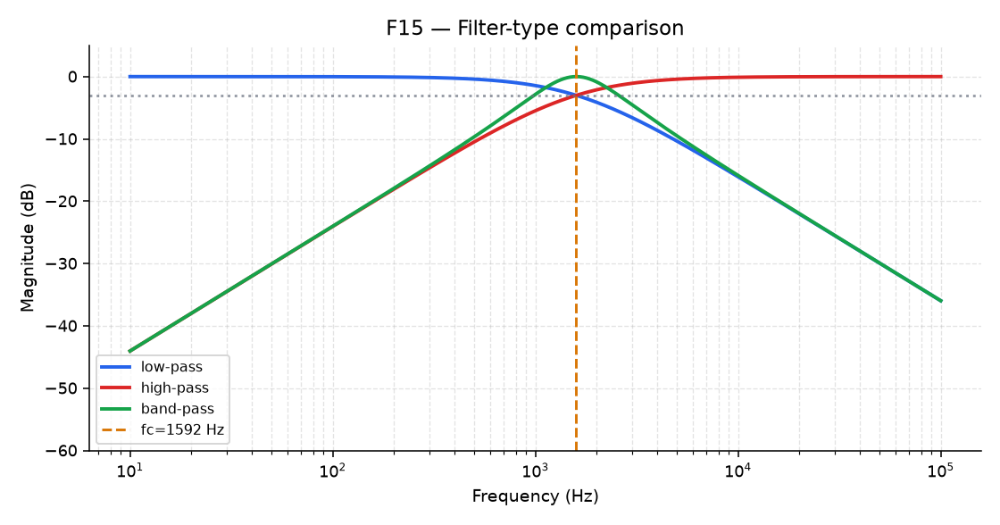

# More filter shapes

A three-band EQ has bass, mid and treble knobs, and behind each knob is a filter with its own shape, which keeps a different slice of the spectrum. Circuits make the same three shapes. The low-pass and the high-pass use the same R and C parts, arranged differently for each shape, but a band-pass that peaks as sharply as the one in F15 needs more than R and C.

| Type | Passes | Blocks | EQ knob it resembles |
|------|--------|--------|------------------------|
| Low-pass | Slow | Fast | Treble cut |
| High-pass | Fast | Slow | Bass cut |
| Band-pass | A middle band | Too slow and too fast | Mid boost / isolate |

All three curves in F15 are built around the same $f_c$, and which side of $f_c$ a filter keeps depends only on the shape of its formula. AD201 comes back to these shapes as blocks you design on purpose, not only as parasitics that turn up by accident.

The band-pass curves in this course come from the textbook second-order formula, which has a quality factor $Q$ that sets how narrow the peak is: the higher the $Q$, the narrower the peak. F15 uses $Q = 1$ and Lab 04's `filter_shapes.py` uses $Q = 2$. You can build a band-pass from R and C alone by following an RC high-pass with an RC low-pass, but with equal parts in both sections its $Q$ is only 1/3 and its peak sits 9.5 dB down, and no choice of R and C gets $Q$ up to 0.5. A band-pass with $Q = 1$ needs an inductor or an amplifier as well.

In [Lab 04](../labs/lab-04-rc-bode-overview.md), Part 4, you'll overlay the three shapes on the F15 explorer, and then plot them from their formulas in a script of your own.

## The three plots

You now have the three plots this course set out to teach: a signal in time (Movement I), a signal as a recipe of sines (Movements II and III), and what a circuit does to that recipe (Movement IV). Analog engineers read these plots every day, and the later analog courses assume you can read them too.

That's the end of Movement IV. Next comes [Lab 04: RC filter and Bode](../labs/lab-04-rc-bode-overview.md), and after it the capstone, [Lab 05: Signal workshop](../labs/lab-05-signal-workshop-overview.md), where you write a script that makes all three plots yourself.

## Where to go next

| Next course | What you carry forward |
|-------------|------------------------|
| AD102 | Passives on silicon: fabricating R, C, L |
| AD103 | Nonlinear devices (diode, MOSFET) in XSchem |
| AD104 | Layout parasitics (why every node is an RC) |
| AD202 (planned) | Sampling and ADCs, where Nyquist matters for real |
