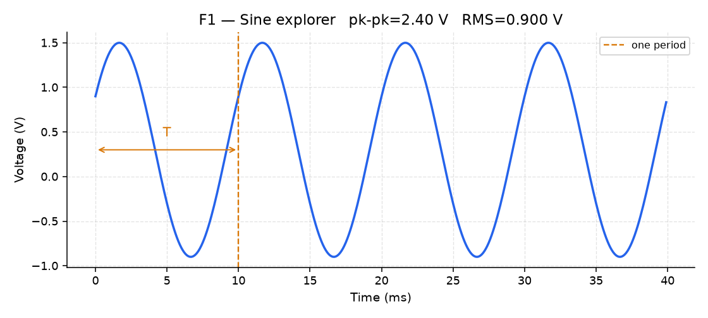

# Pitch and loudness

The held note from the last page is a sine wave, the simplest interesting signal there is. Almost every other signal in this course is built out of sines, so it's worth getting comfortable with the sine's four knobs before you move on.

## The sine wave's knobs

$$
v(t) = A \sin(2\pi f t + \phi) + V_{\mathrm{DC}}
$$

Each symbol in the formula is a knob you could turn on a synthesizer. The table also lists the period $T$, which isn't a separate knob, because the frequency sets it:

| Symbol | Name | Musical intuition | What it means |
|--------|------|--------------------|----------------|
| $A$ | Amplitude | Loudness | How far the wave swings from its center (volts) |
| $f$ | Frequency | Pitch | How many cycles the wave completes per second (hertz, Hz) |
| $T = 1/f$ | Period | Length of one "beat" | How long one cycle lasts (seconds) |
| $\phi$ | Phase | Where in the beat you start | How far the wave is shifted sideways, which sets where in its cycle it starts |
| $V_{\mathrm{DC}}$ | DC offset | No musical equivalent (a mixing desk calls this "bias") | The center line the wave rides on |

If you turn the amplitude knob up, the note gets louder but its pitch stays the same. If you turn the frequency knob up, the pitch rises but the loudness stays the same. The two are independent, which is why the formula gives them separate symbols.

## Two ways to measure "how loud"

- **Peak-to-peak** is the full vertical swing of the wave, from its highest point to its lowest. For a pure sine it's $2A$, because the wave swings $A$ above its center line and $A$ below it.
- **RMS** ("root mean square") measures the signal's effective strength. For a sine with no DC offset, $\mathrm{RMS} = A/\sqrt{2} \approx 0.707\,A$. The power a signal delivers into a resistor depends on its RMS value, not its peak, which is why a multimeter reports RMS rather than amplitude when you measure an AC voltage.

In [Lab 01](../labs/lab-01-signal-explorer-overview.md), Part 3, you'll read the period, peak-to-peak and RMS off the F1 explorer, and then compute the same three numbers in your own script, working out the period from $T = 1/f$ and measuring the other two from an array of samples.

## Why an engineer cares

Outside music, the same quantities come up all the time in circuit work:

| Quantity | Everyday use |
|----------|----------------|
| Amplitude compared with the supply rails | Headroom: whether the signal will clip |
| DC offset | The bias, or operating point, of a circuit (AD103 will make this precise) |
| Frequency | Bandwidth budgets and sampling rates |
| RMS | The number your multimeter reports and your power calculations use |

Next: [A family of waveforms](../guide/a-family-of-waveforms.md)
