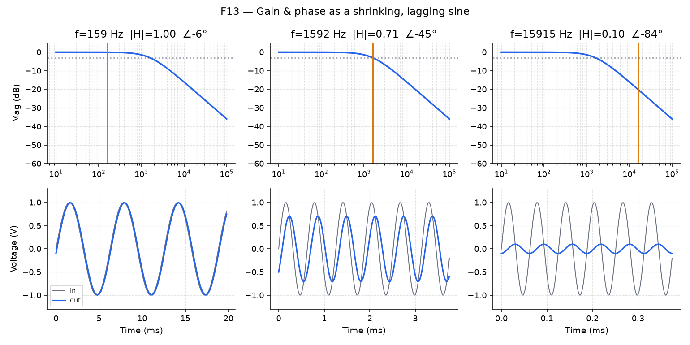

# Reading a Bode plot

A Bode plot shows what a filter does to every frequency, so it works as the filter's spec sheet. You can read it the way you'd read an EQ curve on a mixing console: where the curve is flat, those frequencies come through unchanged; where it slopes down, they come out quieter; and the phase panel tells you how much later each frequency arrives.

## What each feature means

| Feature | Meaning |
|---------|---------|
| Flat region | Passband: the signal comes through almost unchanged |
| −3 dB point | The cutoff frequency $f_c$, which is defined as the point where the gain is down 3 dB |
| −20 dB/decade slope | First-order roll-off: each ×10 in frequency divides the amplitude by 10 |
| Phase → −90° | The phase a single RC approaches at high frequencies |

## Gain and phase as a picture in time

A Bode plot is a summary of many tests, each done at one frequency. Pick a frequency on the curve and drive the filter with a sine at that frequency. What comes out is still a sine at the same frequency, but it's **smaller**, which is the gain, and **later**, which is the phase. A network analyzer draws the two curves by doing exactly this, one sweep point at a time.

Take three points on the RC low-pass curve:

- A decade below $f_c$, the output is almost identical to the input.
- At $f_c$, the output shrinks to about 0.707× the input and lags it by about an eighth of a cycle (45°). Every Bode plot is anchored to this point, the −3 dB cutoff.
- A decade above $f_c$, the output is tiny and lags the input by nearly 90°.

In [Lab 04](../labs/lab-04-rc-bode-overview.md), Part 2 you'll park the F13 marker at these three points, and then draw the input and output sines for each one in your own script.

Next: [Filtering a beat](../guide/filtering-a-beat.md)
