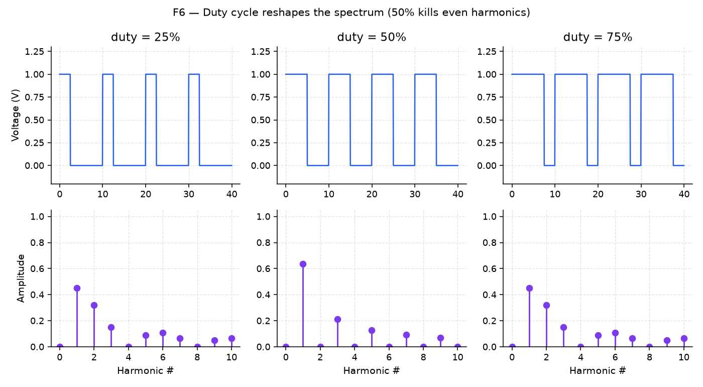

# Rhythm and duty cycle

A metronome that ticks 50/50, on exactly as long as it's off, has a different rhythm from one that snaps and then rests. A pulse train is the same idea: a square wave that isn't 50% on and 50% off. The fraction of each cycle it spends on is its **duty cycle**, and changing the duty cycle changes which harmonics show up in its recipe.

## Duty cycle reshapes the recipe

At exactly 50% duty, the recipe from [Timbre and harmonics](guide/timbre-and-harmonics.md) holds: only odd harmonics are present. Move away from 50% in either direction and the **even** harmonics ($n = 2, 4, 6, \ldots$) come back into the spectrum.

That's one reason clock specs care about duty cycle. A clock's spectral content drives electromagnetic interference (**EMI**), and a clock with a clean, symmetric duty cycle radiates a cleaner spectrum than a lopsided one.

You'll sweep the duty cycle on the F6 explorer and plot the spectra of three pulse trains yourself in [Lab 02](labs/lab-02-harmonic-builder-overview.md), Part 3.

## Why an engineer cares

| Observation | Implication |
|-------------|-------------|
| 50% duty kills even harmonics | Cleaner spectrum, less EMI |
| Off-50% duty | Even harmonics return and radiate at those frequencies |
| Clock spec sheets list a duty-cycle tolerance | It's a spectral-cleanliness spec, not a cosmetic one |

That's the end of Movement II. Next: [Lab 02: Harmonic builder](labs/lab-02-harmonic-builder-overview.md). After the lab, Movement III starts with [The FFT as an equalizer](guide/the-fft-as-an-equalizer.md), which gives you a tool that reads any signal's recipe off automatically instead of you building it up by hand.
