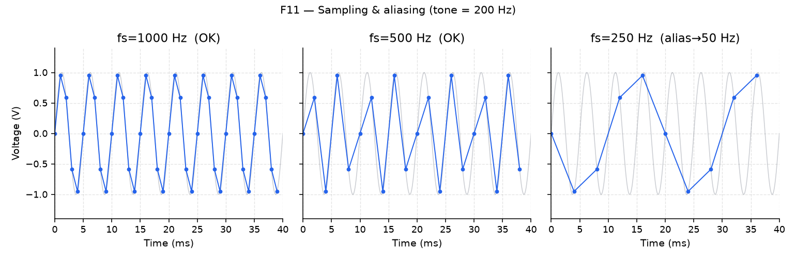

# Sampling fast enough

You've probably seen a car's wheels seem to spin backwards in a video while the car drives forward. The camera captures only a handful of frames per second, and between frames the spokes move almost, but not quite, a full turn, so your brain reconstructs a slow, wrong rotation. Nothing is wrong with the camera; it just isn't sampling often enough to keep up with the real motion, and an ADC measuring a voltage can fail in exactly the same way.

## Sampling and aliasing

If you measure a tone too slowly, a fast sine passes itself off as a slow one, and the fake low-frequency signal you end up seeing is called an **alias**. The rule that prevents it is the Nyquist criterion, which says the sample rate has to be more than twice the highest frequency in the signal:

$$
f_{\mathrm{sample}} > 2\, f_{\mathrm{max}}
\qquad\text{(Nyquist)}
$$

Two related numbers both get called "Nyquist", so it's worth keeping them apart. The Nyquist rate is $2 f_{\mathrm{max}}$, the rate your sample rate has to beat. Half the sample rate, $f_s/2$, is the highest frequency that a given sample rate can represent, and that's the one the F11 explorer labels Nyquist.

## Worked example: a 900 Hz tone

Sample a 900 Hz tone at 5000 samples per second, well above Nyquist, and the sample points trace out a recognizable 900 Hz wiggle. Sample the same tone at 1000 samples per second, below the $2 \times 900 = 1800$ Hz Nyquist rate, and the points join up into a slow, wrong-looking wave, just like the backwards-spinning wheel. The tone is the same in both cases, and the only thing that changed is how often you looked at it.

In [Lab 03](../labs/lab-03-spectrum-detective-overview.md), Part 4 you'll drop the sample rate on the F11 explorer until the tone aliases, and then reproduce this 900 Hz example in a script of your own.

## Why an engineer cares

The sample rate you choose for an ADC decides whether you'll ever see this failure, which is why sample rates are chosen carefully. It's also the starting point for AD202 (mixed signal).

This page ends Movement III, and next comes [Lab 03: Spectrum detective](../labs/lab-03-spectrum-detective-overview.md). After the lab, Movement IV starts with [Filters are tone knobs](../guide/filters-are-tone-knobs.md), where you ask what a circuit does to a signal's recipe instead of only reading the recipe off.
