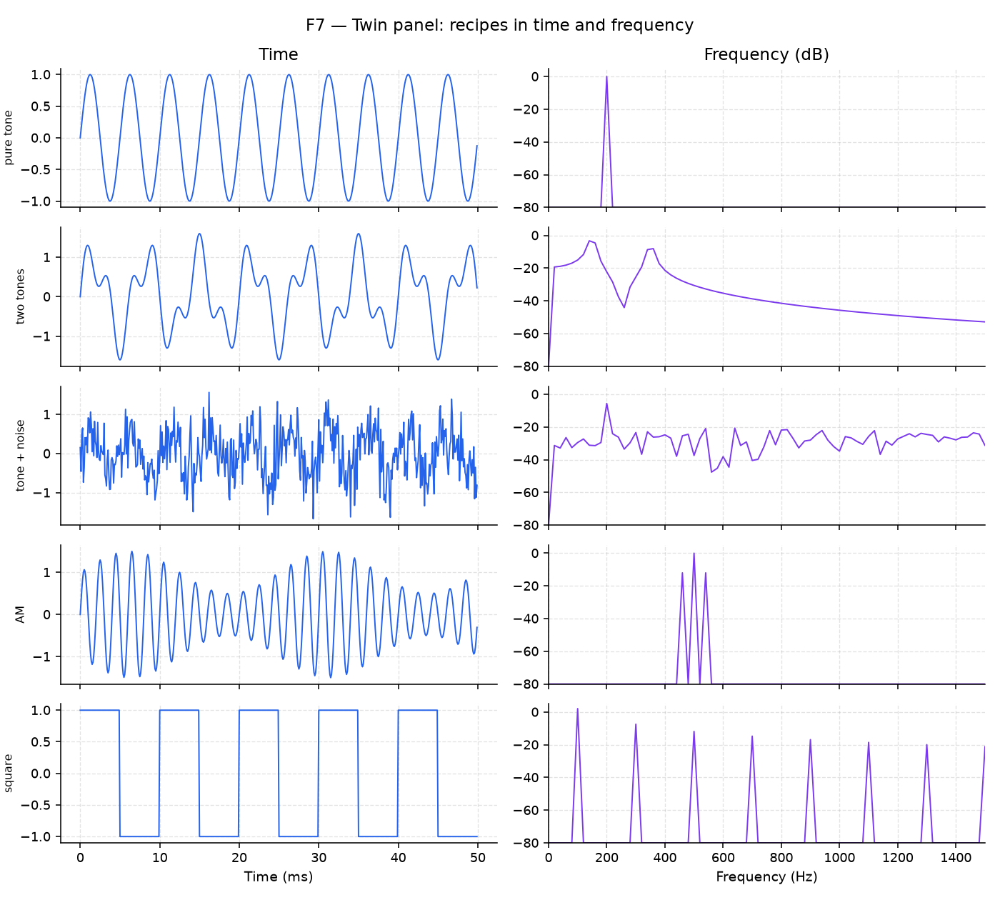

# The FFT as an equalizer

For two movements you've built waveforms out of sines by hand, picking the harmonics and their amplitudes. The **Fast Fourier Transform (FFT)** runs that process backwards: give it a time waveform and it gives you back the recipe. It's the math behind every equalizer display you've seen bounce along to a song.

## The FFT as a machine

Treat the FFT as a black box for now:

```text
  time waveform  ──FFT──►  spectrum (amplitudes vs frequency)
```

You don't need the derivation to use it. `numpy.fft.rfft` does the work in one line, and the Lab 03 explorers run it for you and plot the result.



## Reading a spectrum

| Look for | Meaning |
|----------|---------|
| Where peaks sit | Frequencies present in the signal: the notes in the chord |
| How tall peaks are | Relative strength of each tone: how loud that note is in the mix |
| The noise floor | The smallest features you can still see above the hiss |
| Harmonic combs | Distortion, clocks, square-ish shapes: timbre, from Movement II |

Take a two-note chord, A4 (440 Hz) plus a quieter E5 (659 Hz). Its time plot is two overlapping wiggles, and it's hard to tell by eye that there are exactly two notes. Its spectrum has two clear peaks, at 440 and 659 Hz. That contrast is the reason this movement exists. Identifying a signal by the shape of its spectrum is a core debugging skill.

You'll compute this chord's spectrum yourself, then flip between test signals on the F7 explorer, in [Lab 03](labs/lab-03-spectrum-detective-overview.md), Part 1.

## Decibels

Human ears (and RF engineers) both respond to ratios, not differences. Going from a whisper to a normal voice feels like as big a jump as going from a normal voice to a shout, even though the second jump is a much bigger change in raw voltage. The **decibel** captures that with a logarithm:

$$
\mathrm{dB} = 20\log_{10}\!\left(\frac{A}{A_{\mathrm{ref}}}\right)
$$

These are worth memorizing:

| Linear ratio | dB |
|--------------|-----|
| ×2 | ≈ +6 dB |
| ×10 | +20 dB |
| ×0.5 | ≈ −6 dB |
| ×0.1 | −20 dB |
| $1/\sqrt{2} \approx 0.707$ | −3 dB |

A dB axis lets a loud tone and a quiet tone share one plot without the quiet one disappearing into the baseline. That's why a studio equalizer's meters are marked in dB, not volts.

Next: [Finding a quiet note](guide/finding-a-quiet-note.md)
