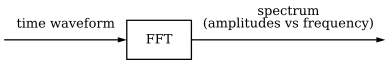

# The FFT as an equalizer

In Movement II you built waveforms out of sines by hand, choosing which harmonics to add and how big each one should be. The **Fast Fourier Transform (FFT)** runs that process backwards: you give it a time waveform, and it gives you back the recipe, which lists the frequencies in the waveform and how strong each one is. It's also the math behind every equalizer display you've seen bouncing along to a song.

## The FFT as a machine

Treat the FFT as a black box for now:

{width=440 fig-alt="A block diagram. An arrow labelled time waveform points into a box labelled FFT, and a second arrow, labelled spectrum (amplitudes vs frequency), leads out of the box."}

You don't need to know how the FFT is derived to use it: `numpy.fft.rfft` does the whole calculation in one line, and the Lab 03 explorers run it for you and plot the result. F7, below, shows five test signals, each with its time plot on the left and its spectrum on the right.

## Reading a spectrum

| Look for | Meaning |
|----------|---------|
| Where peaks sit | The frequencies present in the signal, which for a chord are its notes |
| How tall peaks are | The relative strength of each tone, which is how loud that note is in the mix |
| The noise floor | The level of the hiss, which sets the smallest feature you can still see |
| Harmonic combs | Distortion, clocks or square-ish shapes; in music, a comb is what you hear as the timbre from Movement II |

Take a two-note chord, A4 (440 Hz) plus a quieter E5 (659 Hz). Its time plot is two wiggles on top of each other, and by eye it's hard to tell that there are exactly two notes. Its spectrum shows two clear peaks, one at 440 Hz and one at 659 Hz. That difference between the two views is the reason this movement exists, because identifying a signal by the shape of its spectrum is a core debugging skill.

In [Lab 03](../labs/lab-03-spectrum-detective-overview.md), Part 1, you'll compute this chord's spectrum yourself and then flip between test signals on the F7 explorer.

## Decibels

Human ears and radio-frequency (RF) engineers both care about ratios rather than differences. Going from a whisper to a normal voice feels like as big a jump as going from a normal voice to a shout, even though the second jump is a much bigger change in raw voltage. The **decibel** describes a ratio with a logarithm, so that equal ratios become equal steps:

$$
\mathrm{dB} = 20\log_{10}\!\left(\frac{A}{A_{\mathrm{ref}}}\right)
$$

These few conversions are worth memorizing:

| Linear ratio | dB |
|--------------|-----|
| ×2 | ≈ +6 dB |
| ×10 | +20 dB |
| ×0.5 | ≈ −6 dB |
| ×0.1 | −20 dB |
| $1/\sqrt{2} \approx 0.707$ | −3 dB |

On a dB axis, a loud tone and a quiet tone can share one plot without the quiet one disappearing into the baseline, which is why the meters on a studio equalizer are marked in dB rather than volts.

Next: [Finding a quiet note](../guide/finding-a-quiet-note.md)
