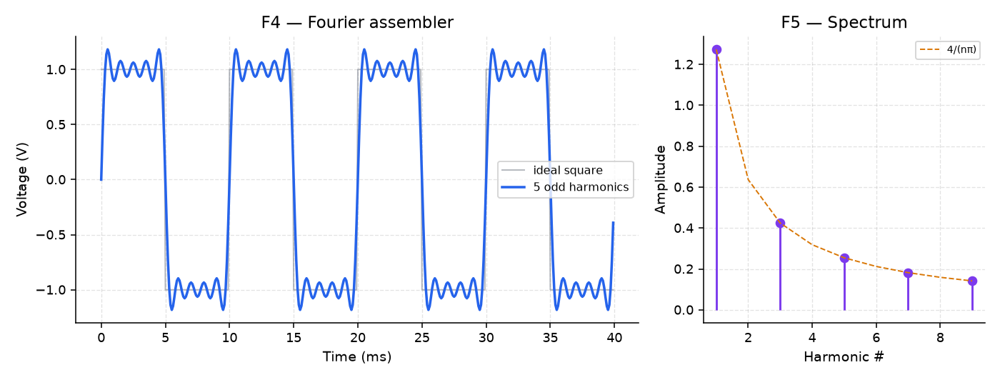

# Timbre and harmonics

Play A4 (440 Hz) on a violin and then on a trumpet, at the same loudness. The two notes have the same pitch and a tuner would read them as identical, but nobody would mistake one instrument for the other. What differs is their **timbre**: each instrument adds its own recipe of extra, quieter tones on top of the main note. Those extra tones are called **harmonics**, and a square wave is the cleanest example of what they do.

## The square wave's recipe

A square wave of amplitude 1 and fundamental frequency $f_0$ can be written as an infinite chord:

$$
v_{\mathrm{square}}(t) = \frac{4}{\pi}\sin(2\pi f_0 t)
  + \frac{4}{3\pi}\sin(2\pi\,3f_0 t)
  + \frac{4}{5\pi}\sin(2\pi\,5f_0 t)
  + \cdots
$$

Only the **odd harmonics** ($n = 1, 3, 5, \ldots$) appear, and their amplitudes fall off as $1/n$: the $n$-th one has amplitude $4/(n\pi)$.

The more terms you add, the closer the sum gets to a perfect square, but near each edge it overshoots and wiggles. This overshoot is called **Gibbs ringing**, and adding more harmonics won't make it go away, because it's a mathematical consequence of approximating a sharp edge with a finite number of sines. You'll see the same shape on an oscilloscope trace of a real digital clock.

## The frequency domain

Since any (nice) signal can be written as a sum of sines, the list of those sines' amplitudes and frequencies describes the signal completely. That list is the signal in the **frequency domain**, and for a musical note it's the instrument's recipe, the thing behind its timbre.

The natural way to draw the recipe is a **stem plot**, which has a stick at each harmonic whose height is that harmonic's amplitude. It's the same idea as the bar display on an equalizer, applied to a single note instead of a whole song. In the figure above, F5 (right) is the stem plot of the waveform in F4 (left).

In [Lab 02](../labs/lab-02-harmonic-builder-overview.md), Part 2 you'll switch harmonics on and off in the F4/F5 explorer, and then add them up yourself in a script.

## Why an engineer cares

| Observation | Implication |
|-------------|-------------|
| A "1 GHz digital clock" needs analog bandwidth ≫ 1 GHz | Its sharp edges are made of the high harmonics, so the bandwidth has to reach them |
| Sharp edges ring | The ringing comes from a truncated harmonic series, or from real interconnect behaving the same way |
| Timbre is the harmonic recipe | Two circuits with the same fundamental can look very different on a spectrum |

Next: [Rhythm and duty cycle](../guide/rhythm-and-duty-cycle.md)
