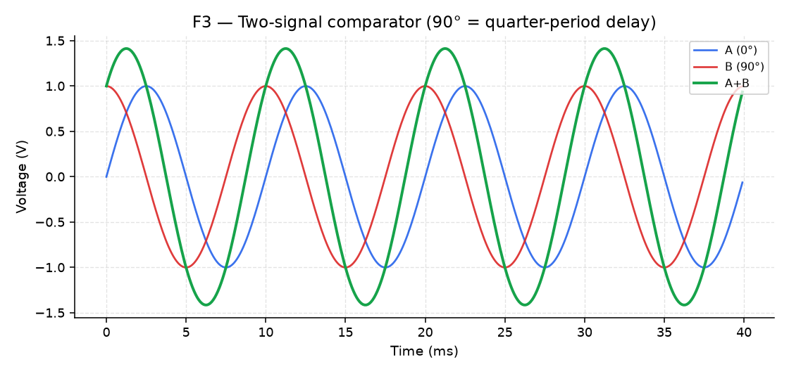

# Two voices in time

Suppose two singers hold the same note at the same pitch and the same loudness, but one of them comes in a fraction of a beat late, so the two voices are offset in time. That offset is called **phase**, and it shows up wherever two signals of the same frequency meet: in two clock domains, in the two channels of a stereo signal, or on two probes of the same scope.

## Phase as a time delay

$$
t_{\mathrm{delay}} = \frac{\phi}{360^\circ} \cdot T
$$

A phase difference is a time delay, measured in degrees of one cycle instead of in seconds. A $90^\circ$ shift is a quarter of a cycle, so at 100 Hz, where the period is 10 ms, it's a 2.5 ms delay. It works the way "a quarter note late" does in music: the same fraction of a beat is a different amount of time at a fast tempo than at a slow one, so you need the frequency before you can turn a phase into a delay.

## Adding two offset voices

When you add two equal sines, the phase between them decides what the sum looks like. At $0^\circ$ the two voices reinforce each other and the sum is tall. As the phase approaches $180^\circ$ they cancel more and more, and the sum flattens out, which is what happens to the sound from two speakers wired backwards.

You'll set the phase on the F3 explorer, check the delay readout against the formula, and plot the two voices and their sum yourself in [Lab 01](../labs/lab-01-signal-explorer-overview.md), Part 5.

## Why an engineer cares

| Quantity | Everyday use |
|----------|----------------|
| Phase / delay | Timing, synchronization, and the reason digital timing closure exists |
| Phase at high frequency | Clock skew between two paths that "should" arrive together |
| Phase margin | A preview of stability analysis in AD201 |

This page ends Movement I. Next comes [Lab 01: Signal explorer](../labs/lab-01-signal-explorer-overview.md). After the lab, Movement II starts with [Adding signals](../guide/adding-signals.md).
