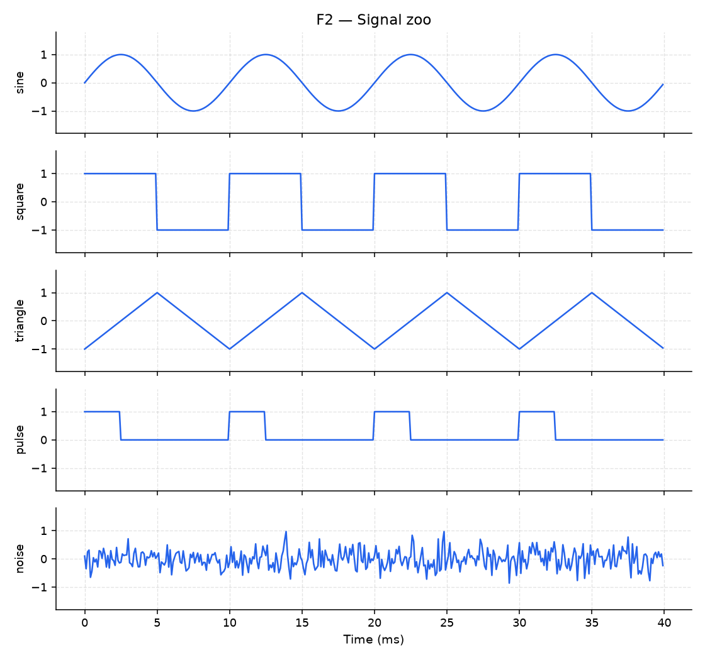
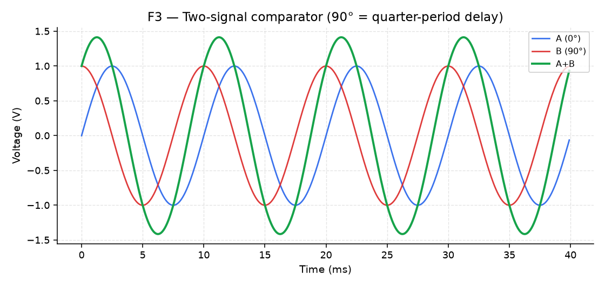

# Lab 01: Signal explorer

You'll load AD101 into your workspace, write your first signal scripts, and use three slider explorers (F1–F3) to measure a sine's period, peak-to-peak and RMS, compare common waveform shapes, and turn a phase difference into a time delay. Before each script runs, you'll write down the numbers you expect it to print.

Lab package: [`labs/lab-01-signal-explorer/`](https://github.com/uoftasic/ad101/tree/main/labs/lab-01-signal-explorer)

## Before you start

- Read [Getting started](guide/getting-started.md) and Movement I: [What is a signal?](guide/what-is-a-signal.md), [Pitch and loudness](guide/pitch-and-loudness.md), [A family of waveforms](guide/a-family-of-waveforms.md) and [Two voices in time](guide/two-voices-in-time.md).
- Keep [Reading plots](reference/reading-plots.md) open as a cheat sheet.
- Have a sheet of paper or a text file for your predictions.

Time: about 1.5 hours.

### How the labs work

Parts 3 to 5 each pair an explorer with a snippet. Part 1 loads the course, and Part 2 is a snippet on its own.

- An **explorer** is a plot window with sliders. You open one with `python3 src/explore.py --figure <id>`. The terminal stays busy until you close the window.
- A **snippet** is a short Python script. Save it as a new `.py` file in the lab folder and run it with `python3 <file>.py`. The steps suggest a file name, but any name works. Snippets only use numpy and matplotlib. The desktop has `gedit`, `nano` and `vim` for editing.

Run explorers and snippets from the lab folder (Part 2 takes you there). If you open a new terminal partway through, run `. /foss/designs/common/.designinit`, `mod ad101` and `cd labs/lab-01-signal-explorer` first. Your snippet files are under `/foss/designs`, so they're in your `workspace` folder on the host and survive a container restart.

## Part 1: Load the course

If you haven't set up the workbench, do [IC101 Lab 03](https://uoftasic.com/ic101/#/labs/lab-03-launch-the-workbench-overview) first.

1. Start the desktop from your `workspace` folder on the host (`./scripts/start_vnc.sh`, or `scripts\start_vnc.bat` on Windows), open it in your browser as in IC101, and open a terminal in the desktop.

2. Load the workspace environment and get AD101:

   ```bash
   . /foss/designs/common/.designinit
   mod add ad101    # first time only: clones github.com/uoftasic/ad101 into modules/ad101
   mod ad101        # every time after that
   ```

   You should see `cwd: /foss/designs/modules/ad101` after `mod ad101`.

   If you'd rather clone on the host, run this from the folder that contains your `workspace` clone instead of `mod add ad101`, then run `mod ad101` in the desktop terminal as above. It ends up in the same folder:

   ```bash
   cd workspace/modules
   git clone https://github.com/uoftasic/ad101.git
   ```

3. Check the Python environment, including the numpy and matplotlib versions:

   ```bash
   python3 scripts/check_env.py
   ```

   You should see:

   ```text
   === AD101 environment check ===
   Python: 3.12.3  (/usr/bin/python3)
   OK   numpy 2.5.2
   OK   matplotlib 3.11.1
   OK   matplotlib backend: qtagg
   OK   interactive GUI backend available
   OK   adsig smoke: peak ≈ 100 Hz (expect ~100)

   === All checks passed ===
   ```

   The outputs printed in Labs 01–05 were checked with these numpy and matplotlib versions in the course image. The backend line names the GUI toolkit matplotlib found, the part of matplotlib that opens plot windows. `adsig` is the course's small signal library in `labs/common/`; the explorers use it.

| What you see | What to do |
|---|---|
| `WARN no interactive GUI backend (Agg / headless)` | The explorers can't open windows. Check that you ran it in a terminal in the noVNC desktop, not on your host, then see "If the GUI won't open" in [Python in the workbench](reference/python-in-the-workbench.md). |
| `FAIL numpy` or `FAIL matplotlib` | Run `pip install --user numpy matplotlib` in the desktop terminal, then run `check_env.py` again. |

For anything else about the desktop, Docker or `mod`, see IC101's [Troubleshooting](https://uoftasic.com/ic101/#/reference/troubleshooting) page.

## Part 2: Plot your first signal

1. Go to the lab folder:

   ```bash
   cd labs/lab-01-signal-explorer
   ```

2. Save this as `first_signal.py` and run it with `python3 first_signal.py`. It's the pair of arrays from [What is a signal?](guide/what-is-a-signal.md), plus four lines that plot them:

   ```python
   import numpy as np
   import matplotlib.pyplot as plt

   t = np.arange(0, 0.05, 1 / 10_000)   # 50 ms of timestamps, 10,000 per second
   v = np.sin(2 * np.pi * 440 * t)      # a voltage at each of those timestamps

   plt.plot(t * 1e3, v)          # ×1e3 to show milliseconds instead of seconds
   plt.xlabel("Time (ms)")
   plt.ylabel("Voltage (V)")
   plt.show()
   ```

You should see a sine wave between −1 V and +1 V across 0 to 50 ms: one held note, A4 at 440 Hz, which is 22 cycles in that window. That's your first signal-analysis script. Close the window to get the terminal back.

## Part 3: Measure a sine (F1)

1. Open the sine explorer:

   ```bash
   python3 src/explore.py --figure f1
   ```

   

2. Leave the sliders at their starting values (amplitude 1, 100 Hz, phase 0°, DC offset 0) and read the box in the top-left corner of the plot.

   You should see `T = 10.00 ms   f = 100 Hz` and `pk-pk = 2.00 V   RMS = 0.707 V`. The dashed vertical line marks one period.

3. Drag Amplitude, Freq (Hz), Phase (°) and DC offset one at a time. Before each drag, predict what the readout will do from $T = 1/f$, peak-to-peak $= 2A$ and $\mathrm{RMS} = A/\sqrt{2}$.

   You should see the period marker track $T = 1/f$, RMS stay at about 0.707× the amplitude while DC is 0, Phase slide the wave sideways, and the DC slider lift the whole wave without changing the size of the wiggle. The RMS readout does go up when you add DC, because RMS counts the offset too. Close the window.

4. Save this as `measure_sine.py` and run it. It builds a sine at a chosen amplitude and frequency, computes the period from $T = 1/f$, and measures peak-to-peak and RMS straight from the array, the way you'd measure a scope trace by eye, except exact:

   ```python
   import numpy as np
   import matplotlib.pyplot as plt

   fs = 10_000                         # samples per second
   t = np.arange(0, 0.05, 1 / fs)      # 50 ms window

   A, f = 1.5, 220.0                   # amplitude (V), frequency (Hz) — the note A3
   v = A * np.sin(2 * np.pi * f * t)

   period_s = 1 / f
   peak_to_peak = v.max() - v.min()
   rms = np.sqrt(np.mean(v**2))

   print(f"T = {period_s*1e3:.2f} ms   pk-pk = {peak_to_peak:.2f} V   RMS = {rms:.3f} V")

   plt.plot(t * 1e3, v)
   plt.axvline(period_s * 1e3, color="orange", linestyle="--", label="one period")
   plt.xlabel("Time (ms)")
   plt.ylabel("Voltage (V)")
   plt.legend()
   plt.show()
   ```

   You should see `T = 4.55 ms   pk-pk = 3.00 V   RMS = 1.061 V` printed, and a plot with an orange dashed line at one period.

5. Change `A` and `f`. Before you re-run, write down what you expect the three printed numbers to be.

   You should see your predicted numbers in the printout. If they disagree, find out why before you move on. It's the most useful five minutes you'll spend all week.

## Part 4: Compare waveform shapes (F2)

1. Open the signal zoo:

   ```bash
   python3 src/explore.py --figure f2
   ```

   

2. Click through sine, square, triangle, pulse and noise on the left. With pulse selected, sweep the Duty slider (it starts at 0.25), and compare 0.25 with 0.5.

   You should see five very different shapes from the same Amplitude setting. Noise never repeats. The pulse at 25% duty looks clearly lopsided next to the pulse at 50%. Close the window.

3. Save this as `waveform_zoo.py` and run it. Besides a sine (which it doesn't plot), it builds square, pulse and triangle from the same time array `t`, using a `phase` variable that counts from 0 to 1 once per cycle, and adds a noise trace:

   ```python
   import numpy as np
   import matplotlib.pyplot as plt

   fs = 10_000
   t = np.arange(0, 0.02, 1 / fs)     # 20 ms window
   f = 200.0                          # Hz

   sine = np.sin(2 * np.pi * f * t)

   # phase goes 0 -> 1 once per cycle; comparing it to a threshold builds
   # square, pulse, and triangle without any new math
   phase = (f * t) % 1.0

   square = np.where(phase < 0.5, 1.0, -1.0)          # snap high/low at the halfway point
   pulse = np.where(phase < 0.25, 1.0, 0.0)           # on 25% of the cycle (duty = 0.25)
   triangle = np.where(phase < 0.5, -1 + 4 * phase, 3 - 4 * phase)   # ramp up, ramp down
   noise = 0.3 * np.random.default_rng(0).standard_normal(len(t))

   fig, axes = plt.subplots(4, 1, sharex=True, figsize=(7, 6))
   for ax, y, name in zip(axes, [square, pulse, triangle, noise], ["square", "pulse (25%)", "triangle", "noise"]):
       ax.plot(t * 1e3, y)
       ax.set_ylabel(name, fontsize=9)
   axes[-1].set_xlabel("Time (ms)")
   plt.tight_layout()
   plt.show()
   ```

   You should see four stacked plots (square, pulse at 25%, triangle and noise) over a 20 ms window.

4. Change the `0.25` in the `pulse` line to `0.5`, then to `0.75`, re-running each time.

   You should see the on-time of each pulse grow. That single number is the duty cycle, which you'll meet again in [Rhythm and duty cycle](guide/rhythm-and-duty-cycle.md).

## Part 5: Turn phase into delay (F3)

1. Open the two-signal comparator:

   ```bash
   python3 src/explore.py --figure f3
   ```

   

   It starts at Phase Δ = 60° and 100 Hz. Phase Δ is the phase difference $\phi$ between the two signals; the readout shows it as Δφ. Signal A is $\sin(2\pi f t)$ and signal B is $\sin(2\pi f t + \phi)$, so it's offset from signal A in time by $t_{\mathrm{delay}} = \frac{\phi}{360^\circ}\,T$. With a positive $\phi$, B runs ahead of A; the readout calls the size of that offset the delay.

2. Before you move anything, use the formula to predict the delay for a 90° phase difference at 100 Hz.

3. Set Phase Δ to 90° and read the delay in the box.

   You should see `delay = 2.500 ms`, a quarter of the 10 ms period.

4. Sweep Phase Δ from 0° to 180° and watch the green sum A+B.

   You should see the sum tall at 0° and cancelled flat at 180°. Close the window.

5. Save this as `two_voices.py` and run it:

   ```python
   import numpy as np
   import matplotlib.pyplot as plt

   fs = 10_000
   t = np.arange(0, 0.02, 1 / fs)
   f = 100.0                      # Hz
   phase_deg = 90.0                # try 0, 60, 180, 360

   voice_a = np.sin(2 * np.pi * f * t)
   voice_b = np.sin(2 * np.pi * f * t + np.deg2rad(phase_deg))
   together = voice_a + voice_b

   delay_ms = (phase_deg / 360.0) * (1000.0 / f)
   print(f"delay = {delay_ms:.3f} ms  (period = {1000.0/f:.2f} ms)")

   plt.plot(t * 1e3, voice_a, label="voice A")
   plt.plot(t * 1e3, voice_b, label="voice B")
   plt.plot(t * 1e3, together, label="A + B", linewidth=2)
   plt.xlabel("Time (ms)")
   plt.ylabel("Voltage (V)")
   plt.legend()
   plt.show()
   ```

   You should see `delay = 2.500 ms  (period = 10.00 ms)`, the same delay F3 showed.

6. Set `phase_deg` to 0, 60, 180 and 360 in turn and re-run.

   You should see the `A + B` trace tall at 0° (the voices reinforce each other) and flat at 180° (they cancel). 360° looks the same as 0°.

## Finishing

You're done when all of these hold:

- F1 at amplitude 1, 100 Hz, DC 0 reads $T \approx 10$ ms, pk-pk ≈ 2 V, RMS ≈ 0.707 V.
- F3 at $\Delta\phi = 90^\circ$ and 100 Hz reads a delay of about 2.5 ms.
- The F2 pulse at 25% duty looks clearly asymmetric next to 50%.
- Your four snippet files run, and `measure_sine.py` and `two_voices.py` print the values above.

Keep your snippet files. Lab 05 asks you to write the same kinds of pieces again, assembled into one script.

Next: Movement II, starting with [Adding signals](guide/adding-signals.md).
