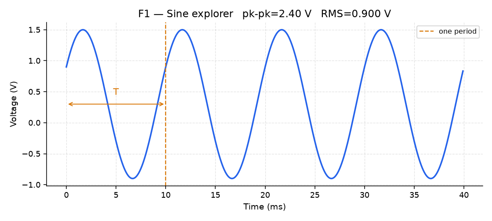

# Lab 01: Signal explorer

You'll load AD101 into your workspace, write your first signal scripts, and use three slider explorers (F1–F3) to measure a sine's period, peak-to-peak and RMS, compare common waveform shapes, and turn a phase difference into a time delay. Before each script runs, you'll write down the numbers you expect it to print.

Lab package: [`labs/lab-01-signal-explorer/`](https://github.com/uoftasic/ad101/tree/main/labs/lab-01-signal-explorer)

## Before you start

- Read [Getting started](../guide/getting-started.md) and Movement I: [What is a signal?](../guide/what-is-a-signal.md), [Pitch and loudness](../guide/pitch-and-loudness.md), [A family of waveforms](../guide/a-family-of-waveforms.md) and [Two voices in time](../guide/two-voices-in-time.md).
- Keep [Reading plots](../reference/reading-plots.md) open as a cheat sheet.
- Have a sheet of paper or a text file for your predictions.

Time: about 1.5 hours.

### How the labs work

Part 1 loads the course and Part 2 is a snippet on its own. Parts 3 to 5 each pair an explorer with a snippet, and the list below explains what each of those is.

- An **explorer** is a plot window with sliders, which you open with `python3 src/explore.py --figure <id>`. The terminal stays busy until you close the window.
- A **snippet** is a short Python script that you save as a new `.py` file in the lab folder and run with `python3 <file>.py`. The steps suggest a file name for each one, but any name works. Snippets use only numpy and matplotlib, and the desktop has `gedit`, `nano` and `vim` for editing them.

Run explorers and snippets from the lab folder, which Part 2 takes you to. If you open a new terminal partway through, run `mod ad101` and `cd labs/lab-01-signal-explorer` first, to get back to the lab folder. Your snippet files are under `/foss/designs`, which is your `workspace` folder on the host, so they survive a container restart.

## Part 1: Load the course

If you haven't set up the workbench, do [IC101 Lab 03](https://uoftasic.com/ic101/labs/lab-03-launch-the-workbench-overview.html) first.

1. Start the desktop from your `workspace` folder on the host (`./scripts/start_vnc.sh`, or `scripts\start_vnc.bat` on Windows), open it in your browser as in IC101, and open a terminal in the desktop.

2. Load the workspace environment and get AD101:

   ```bash
   . /foss/designs/common/.designinit
   mod add ad101    # first time only: clones github.com/uoftasic/ad101 into modules/ad101
   mod ad101        # every time after that
   ```

   You should see `cwd: /foss/designs/modules/ad101` after `mod ad101`.

3. Check the Python environment, including the numpy and matplotlib versions:

   ```bash
   python3 scripts/check_env.py
   ```

   You should see:

   ```text
   === AD101 environment check ===
   Python: 3.12.3  (/usr/bin/python3)
   OK   numpy 2.5.2
   OK   matplotlib 3.11.1
   OK   matplotlib backend: qtagg
   OK   interactive GUI backend available
   OK   adsig smoke: peak ≈ 100 Hz (expect ~100)

   === All checks passed ===
   ```

   We checked the outputs printed in Labs 01–05 with these numpy and matplotlib versions, in the IIC-OSIC-TOOLS 2026.08 image that the workbench runs. If your versions differ and a printed number disagrees with these pages, the difference may come from the version rather than from your code. The backend is the part of matplotlib that opens plot windows, and the `matplotlib backend:` line names the GUI toolkit that matplotlib found to do it. `adsig` is the course's small signal library, in `labs/common/`, and the explorers use it, so the `adsig smoke` line checks that it works.

If `check_env.py` prints one of these lines, here's what to do:

| What you see | What to do |
|---|---|
| `WARN no interactive GUI backend (Agg / headless)` | matplotlib has no way to open a window, so the explorers won't work. First check that you ran `check_env.py` in a terminal in the noVNC desktop, not on your host. If you did, see "If the GUI won't open" in [Python in the workbench](../reference/python-in-the-workbench.md). |
| `FAIL numpy` or `FAIL matplotlib` | Run `pip install --user numpy matplotlib` in the desktop terminal, then run `check_env.py` again. The packages are installed inside the container rather than in your `workspace` folder, so you'll have to repeat the install if you remove the container. |

For anything else about the desktop, Docker or `mod`, see IC101's [Troubleshooting](https://uoftasic.com/ic101/reference/troubleshooting.html) page.

## Part 2: Plot your first signal

What does the pair of arrays from [What is a signal?](../guide/what-is-a-signal.md) look like as a plot?

1. Go to the lab folder:

   ```bash
   cd labs/lab-01-signal-explorer
   ```

2. Save this as `first_signal.py`. It's the pair of arrays from [What is a signal?](../guide/what-is-a-signal.md), plus four lines that plot them:

   ```python
   import numpy as np
   import matplotlib.pyplot as plt

   t = np.arange(0, 0.05, 1 / 10_000)   # 50 ms of timestamps, 10,000 per second
   v = np.sin(2 * np.pi * 440 * t)      # a voltage at each of those timestamps

   plt.plot(t * 1e3, v)          # ×1e3 to show milliseconds instead of seconds
   plt.xlabel("Time (ms)")
   plt.ylabel("Voltage (V)")
   plt.show()
   ```

3. Before you run it, work out how many full cycles of a 440 Hz sine fit in the 50 ms window and write the number down. Then run it with `python3 first_signal.py`.

You should see a sine wave swinging between −1 V and +1 V across 0 to 50 ms. It's one held note, A4 at 440 Hz, and 22 cycles of it fit in the window. Close the window to get the terminal back.

## Part 3: Measure a sine (F1)

How does each of a sine's four knobs (amplitude, frequency, phase and DC offset) change its period, peak-to-peak and RMS?

1. Open the sine explorer:

   ```bash
   python3 src/explore.py --figure f1
   ```

   

2. Leave the sliders at their starting values (amplitude 1, 100 Hz, phase 0°, DC offset 0) and read the box in the top-left corner of the plot.

   You should see `T = 10.00 ms   f = 100 Hz` and `pk-pk = 2.00 V   RMS = 0.707 V`. The dashed vertical line marks one period.

3. Drag Amplitude, Freq (Hz), Phase (°) and DC offset one at a time, putting each back to its starting value before you move the next. Before each drag, write down what you expect the readout to do. The formulas $T = 1/f$, peak-to-peak $= 2A$ and $\mathrm{RMS} = A/\sqrt{2}$ tell you what Amplitude and Freq will do; for Phase and DC offset you'll have to make a guess.

   You should see the period marker track $T = 1/f$, RMS stay at about 0.707× the amplitude while DC is 0, Phase slide the wave sideways, and the DC slider lift the whole wave without changing the size of the wiggle. With DC offset at 0.5 and the other sliders at their starting values, the box reads `pk-pk = 2.00 V   RMS = 0.866 V`.

   Why does RMS go up when you add DC, while pk-pk stays the same?

   <details>
   <summary>Answer</summary>

   RMS is the square root of the mean of $v^2$ over the window. A DC offset shifts every sample by the same amount, which changes every $v^2$, so the offset shows up in the RMS. Peak-to-peak is the maximum minus the minimum, and because the shift moves both of them by the same amount, it cancels out of the difference.

   </details>

   Close the window.

4. Save this as `measure_sine.py`, but don't run it yet. It builds a sine at a chosen amplitude and frequency, computes the period from $T = 1/f$, and measures peak-to-peak and RMS from the samples in the array, rather than off a scope trace by eye:

   ```python
   import numpy as np
   import matplotlib.pyplot as plt

   fs = 10_000                         # samples per second
   t = np.arange(0, 0.05, 1 / fs)      # 50 ms window

   A, f = 1.5, 220.0                   # amplitude (V), frequency (Hz) — the note A3
   v = A * np.sin(2 * np.pi * f * t)

   period_s = 1 / f
   peak_to_peak = v.max() - v.min()
   rms = np.sqrt(np.mean(v**2))

   print(f"T = {period_s*1e3:.2f} ms   pk-pk = {peak_to_peak:.2f} V   RMS = {rms:.3f} V")

   plt.plot(t * 1e3, v)
   plt.axvline(period_s * 1e3, color="orange", linestyle="--", label="one period")
   plt.xlabel("Time (ms)")
   plt.ylabel("Voltage (V)")
   plt.legend()
   plt.show()
   ```

   Before you run it, use the three formulas from step 3 to work out what it will print for A = 1.5 V and f = 220 Hz, and write the numbers down. Then run it.

   You should see `T = 4.55 ms   pk-pk = 3.00 V   RMS = 1.061 V` printed, and a plot with an orange dashed line at one period.

5. Pick your own values of `A` and `f`. Write down the T, pk-pk and RMS you expect, then change the two values in the script and re-run. Keep your numbers and the printout for the Finishing section at the end of this page.

   You should see your predicted numbers in the printout. If a number is off by more than its last digit, recheck your arithmetic and your edit before you move on.

   If a number is off in its last digit, why?

   <details>
   <summary>Answer</summary>

   The script measures the sampled array rather than evaluating the formulas, and a finite set of samples doesn't always match them exactly. If $f \times 0.05$ s isn't a whole number, the 50 ms window ends partway through a cycle and RMS comes out slightly off; for example, A = 1, f = 333 Hz prints `RMS = 0.705 V`. If no sample lands exactly on a peak, pk-pk comes out a little short; A = 2, f = 200 Hz prints `pk-pk = 3.99 V`.

   </details>

## Part 4: Compare waveform shapes (F2)

How do square, triangle, pulse and noise differ from a sine, and what does the duty cycle change?

1. Open the signal zoo:

   ```bash
   python3 src/explore.py --figure f2
   ```

   

2. Click through sine, square, triangle, pulse and noise on the left. With pulse selected, sweep the Duty slider (it starts at 0.25), and compare 0.25 with 0.5.

   You should see five very different shapes from the same Amplitude setting, and noise is the only one that never repeats. At 25% duty the pulse looks clearly lopsided next to the pulse at 50%. Close the window.

3. Save this as `waveform_zoo.py` and run it. It builds a sine, which it doesn't plot, and then square, pulse and triangle waves from the same time array `t`, using a `phase` variable that counts from 0 to 1 once per cycle. It also adds a noise trace:

   ```python
   import numpy as np
   import matplotlib.pyplot as plt

   fs = 10_000
   t = np.arange(0, 0.02, 1 / fs)     # 20 ms window
   f = 200.0                          # Hz

   sine = np.sin(2 * np.pi * f * t)

   # phase goes 0 -> 1 once per cycle; comparing it to a threshold builds
   # square, pulse, and triangle without any new math
   phase = (f * t) % 1.0

   square = np.where(phase < 0.5, 1.0, -1.0)          # snap high/low at the halfway point
   pulse = np.where(phase < 0.25, 1.0, 0.0)           # on 25% of the cycle (duty = 0.25)
   triangle = np.where(phase < 0.5, -1 + 4 * phase, 3 - 4 * phase)   # ramp up, ramp down
   noise = 0.3 * np.random.default_rng(0).standard_normal(len(t))

   fig, axes = plt.subplots(4, 1, sharex=True, figsize=(7, 6))
   for ax, y, name in zip(axes, [square, pulse, triangle, noise], ["square", "pulse (25%)", "triangle", "noise"]):
       ax.plot(t * 1e3, y)
       ax.set_ylabel(name, fontsize=9)
   axes[-1].set_xlabel("Time (ms)")
   plt.tight_layout()
   plt.show()
   ```

   You should see four stacked plots (square, pulse at 25%, triangle and noise) over a 20 ms window.

4. Change the `0.25` in the `pulse` line to `0.5`, then to `0.75`, re-running each time.

   You should see the on-time of each pulse grow. The number you changed is the duty cycle, the fraction of each cycle that the pulse is on, and you'll meet it again in [Rhythm and duty cycle](../guide/rhythm-and-duty-cycle.md).

## Part 5: Turn phase into delay (F3)

How long is a phase difference in milliseconds, and what does it do to the sum of two equal sines?

1. Open the two-signal comparator:

   ```bash
   python3 src/explore.py --figure f3
   ```

   

   The explorer starts at Phase Δ = 60° and 100 Hz. The Phase Δ slider sets the phase difference $\phi$ between the two signals, which the readout labels Δφ. Signal A is $\sin(2\pi f t)$ and signal B is $\sin(2\pi f t + \phi)$, so B is offset from A in time by $t_{\mathrm{delay}} = \frac{\phi}{360^\circ}\,T$. With a positive $\phi$, B runs ahead of A by $t_{\mathrm{delay}}$, and the readout shows that time as `delay`.

2. Before you move anything, use the formula to predict the delay for a 90° phase difference at 100 Hz, and write it down.

3. Set Phase Δ to 90° and read the delay in the box.

   You should see `delay = 2.500 ms`, a quarter of the 10 ms period.

4. Sweep Phase Δ from 0° to 180° and watch the green sum A+B.

   You should see the sum at its tallest at 0° and cancelled to a flat line at 180°. Close the window.

5. Save this as `two_voices.py` and run it:

   ```python
   import numpy as np
   import matplotlib.pyplot as plt

   fs = 10_000
   t = np.arange(0, 0.02, 1 / fs)
   f = 100.0                      # Hz
   phase_deg = 90.0                # try 0, 60, 180, 360

   voice_a = np.sin(2 * np.pi * f * t)
   voice_b = np.sin(2 * np.pi * f * t + np.deg2rad(phase_deg))
   together = voice_a + voice_b

   delay_ms = (phase_deg / 360.0) * (1000.0 / f)
   print(f"delay = {delay_ms:.3f} ms  (period = {1000.0/f:.2f} ms)")

   plt.plot(t * 1e3, voice_a, label="voice A")
   plt.plot(t * 1e3, voice_b, label="voice B")
   plt.plot(t * 1e3, together, label="A + B", linewidth=2)
   plt.xlabel("Time (ms)")
   plt.ylabel("Voltage (V)")
   plt.legend()
   plt.show()
   ```

   You should see `delay = 2.500 ms  (period = 10.00 ms)`, the same delay F3 showed.

6. Predict the delay the script will print for `phase_deg` = 0, 60, 180 and 360, and write the four numbers down. Then set `phase_deg` to each in turn and re-run.

   You should see `delay = 0.000 ms`, `delay = 1.667 ms`, `delay = 5.000 ms` and `delay = 10.000 ms`. The `A + B` trace is tall at 0° and flat at 180°, and 360° looks the same as 0°.

   Why is the sum flat at 180°, and why does 360° look like 0° when the delay is 10 ms?

   <details>
   <summary>Answer</summary>

   At 180°, B is offset from A by half a period, 5 ms at 100 Hz, so B is at its lowest point whenever A is at its highest. In other words B is $-A$, so the two cancel. At 360°, the offset is a whole period, 10 ms, and a sine shifted by one full period lands back on itself, so B is A again and the two reinforce each other as they do at 0°.

   </details>

## Finishing

You're done when `measure_sine.py`, run with an A and f you chose, prints the T, pk-pk and RMS you wrote down before running it, to within the last digit (Part 3, step 5), and `two_voices.py` prints the four delays you predicted (Part 5, step 6).

### Questions

1. Why does RMS go up with a DC offset while peak-to-peak stays the same? (Answered in Part 3, step 3.)
2. Why does the sum of two equal sines cancel at 180°, and come back at 360°? (Answered in Part 5, step 6.)

### Submit

Nothing to submit.

Keep your snippet files anyway, because Lab 05 asks you to write the same kinds of pieces again and assemble them into one script.

Next on the [Course path](../index.md#course-path): read Movement II, [Adding signals](../guide/adding-signals.md), [Timbre and harmonics](../guide/timbre-and-harmonics.md) and [Rhythm and duty cycle](../guide/rhythm-and-duty-cycle.md), then do [Lab 02: Harmonic builder](../labs/lab-02-harmonic-builder-overview.md).
