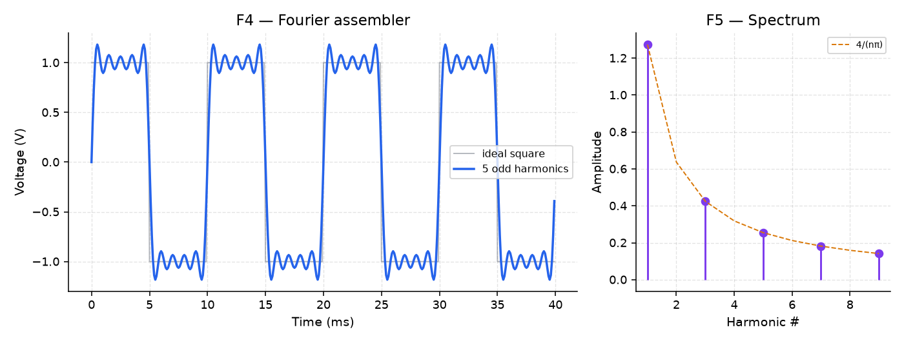
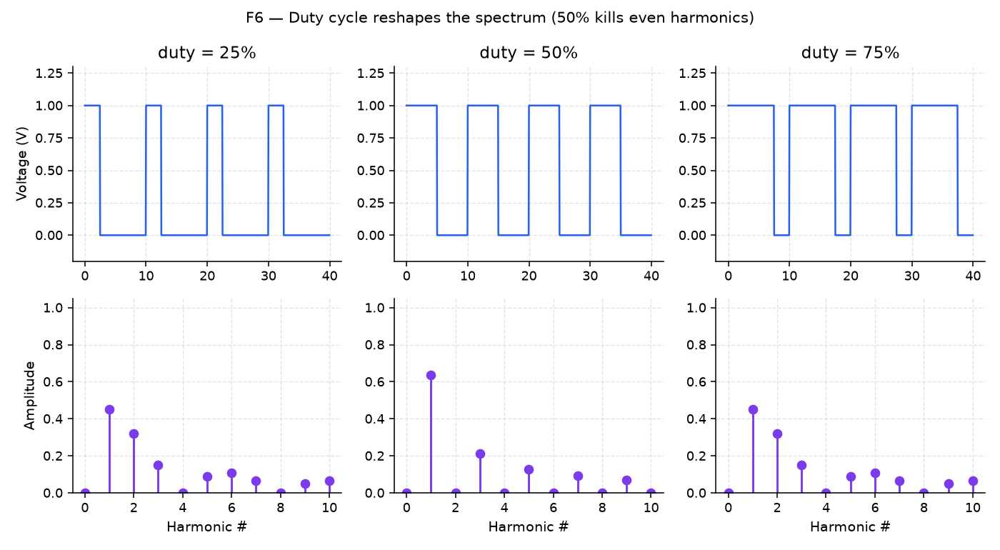

# Lab 02: Harmonic builder

You'll add sines together into a chord, build a square wave out of odd harmonics while its spectrum updates beside it, and watch the duty cycle of a pulse train switch even harmonics on and off.

Lab package: [`labs/lab-02-harmonic-builder/`](https://github.com/uoftasic/ad101/tree/main/labs/lab-02-harmonic-builder)

## Before you start

- Finish [Lab 01](labs/lab-01-signal-explorer-overview.md).
- Read Movement II: [Adding signals](guide/adding-signals.md), [Timbre and harmonics](guide/timbre-and-harmonics.md) and [Rhythm and duty cycle](guide/rhythm-and-duty-cycle.md).
- In a terminal in the noVNC desktop, go to the lab folder:

  ```bash
  . /foss/designs/common/.designinit
  mod ad101
  cd labs/lab-02-harmonic-builder
  ```

Time: about 1 hour.

As in Lab 01, each part pairs an explorer (`python3 src/explore.py --figure <id>`) with a snippet you save as a new `.py` file in this folder and run with `python3 <file>.py`.

## Part 1: Build a chord

1. Save this as `chord.py` and run it. It adds the three notes of a C-major triad, sample by sample:

   ```python
   import numpy as np
   import matplotlib.pyplot as plt

   fs = 10_000
   t = np.arange(0, 0.02, 1 / fs)

   # a C-major triad: C4, E4, G4 (Hz)
   c = np.sin(2 * np.pi * 261.6 * t)
   e = np.sin(2 * np.pi * 329.6 * t)
   g = np.sin(2 * np.pi * 392.0 * t)

   chord = c + e + g

   fig, axes = plt.subplots(2, 1, sharex=True, figsize=(7, 5))
   axes[0].plot(t * 1e3, c, label="C4", alpha=0.7)
   axes[0].plot(t * 1e3, e, label="E4", alpha=0.7)
   axes[0].plot(t * 1e3, g, label="G4", alpha=0.7)
   axes[0].legend(fontsize=8)
   axes[0].set_ylabel("three notes")

   axes[1].plot(t * 1e3, chord, color="black")
   axes[1].set_ylabel("sum (the chord)")
   axes[1].set_xlabel("Time (ms)")
   plt.tight_layout()
   plt.show()
   ```

You should see the three notes in the top panel and their sum in black in the bottom panel. Look at the bottom trace: you can't tell by eye that it's three sines. That's the blind spot Movement III fixes.

## Part 2: Build a square wave from sines (F4/F5)

1. Open the Fourier assembler. F4 (the waveform) and F5 (its spectrum) share one window:

   ```bash
   python3 src/explore.py --figure f4
   ```

   

2. All five harmonics (n=1, 3, 5, 7, 9) start ticked, with amplitudes set to $4/(n\pi)$. Untick 3, 5, 7 and 9 so only n=1 is left.

   You should see a plain sine in F4 and a single stem in F5.

3. Tick 3, 5, 7 and 9 back on, one at a time.

   You should see the sum walk toward the gray ideal square, with an overshoot near each edge that doesn't go away. The F5 stems update in step with the waveform and sit on the dashed $4/(n\pi)$ curve, which is the fingerprint of a square.

4. Drag the amplitude sliders (A1 to A9) toward and away from $4/(n\pi)$.

   You should see the sum stop looking like a square as the stems move off the dashed curve, and return to one as they move back. Close the window.

5. Save this as `square_from_sines.py` and run it:

   ```python
   import numpy as np
   import matplotlib.pyplot as plt

   fs = 10_000
   t = np.arange(0, 0.02, 1 / fs)
   f0 = 200.0                       # fundamental frequency, Hz

   harmonics = [1, 3, 5, 7, 9]       # odd harmonics only
   built = np.zeros_like(t)
   for n in harmonics:
       amplitude = 4 / (n * np.pi)   # the recipe from the formula above
       built += amplitude * np.sin(2 * np.pi * n * f0 * t)

   ideal_square = np.sign(np.sin(2 * np.pi * f0 * t))

   plt.plot(t * 1e3, ideal_square, color="gray", linestyle="--", label="ideal square")
   plt.plot(t * 1e3, built, label=f"sum of {len(harmonics)} harmonics")
   plt.xlabel("Time (ms)")
   plt.ylabel("Voltage (V)")
   plt.legend()
   plt.show()
   ```

   The `4 / (n * np.pi)` line is the recipe from the square-wave formula in [Timbre and harmonics](guide/timbre-and-harmonics.md).

   You should see the sum of five harmonics close to the dashed square, with ringing at the edges.

6. Change the list to `harmonics = [1]` and re-run. Then add `3`, then `5`, `7` and `9`, re-running each time.

   You should see the sum start as a plain sine and walk toward the dashed square with each sine you add. The little overshoot right at the edges appears and stays, however many harmonics you add. That's Gibbs ringing, not a bug in your code.

## Part 3: Duty cycle and even harmonics (F6)

1. Open the duty-cycle explorer:

   ```bash
   python3 src/explore.py --figure f6
   ```

   

   It starts at 50% duty. The box under the plots reads `duty = 50%   →   even harmonics GONE (50% duty)`.

2. Sweep Duty from 25% to 50% to 75% and watch the even-numbered stems in the spectrum.

   You should see the even stems vanish at exactly 50% and come back on either side of it (harmonic 2 is the easiest to spot), with the box switching to `even harmonics PRESENT`. Close the window.

3. Save this as `duty_sweep.py` and run it. It uses `np.fft.rfft`, the "count the harmonics for me" machine you'll meet properly in [The FFT as an equalizer](guide/the-fft-as-an-equalizer.md). For now, treat it as a black box:

   ```python
   import numpy as np
   import matplotlib.pyplot as plt

   fs = 10_000
   t = np.arange(0, 0.05, 1 / fs)
   f0 = 200.0

   fig, axes = plt.subplots(1, 3, figsize=(10, 3), sharey=True)
   for ax, duty in zip(axes, [0.25, 0.50, 0.75]):
       phase = (f0 * t) % 1.0
       pulse = np.where(phase < duty, 1.0, 0.0)
       spectrum = np.abs(np.fft.rfft(pulse - pulse.mean()))
       freqs = np.fft.rfftfreq(len(pulse), d=1 / fs)
       ax.stem(freqs[:100], spectrum[:100])
       ax.set_title(f"duty = {duty:.0%}")
       ax.set_xlabel("Frequency (Hz)")
   plt.tight_layout()
   plt.show()
   ```

You should see three stem plots from 0 to 2000 Hz. In the middle panel (50%) the only stems are at odd multiples of 200 Hz: 200, 600, 1000, 1400 and 1800 Hz. The 25% and 75% panels also have stems at even multiples, such as 400 Hz.

## Finishing

You're done when all of these hold:

- With harmonics 1, 3, 5, 7 and 9 at $4/(n\pi)$, the F4 waveform closely matches the ideal square, with Gibbs ringing at the edges.
- On F6 at 50% duty the even stems are about zero and the box reads `even harmonics GONE`. At 25% they're clearly visible.
- Your three snippets run and show the plots described above.

Next: Movement III, starting with [The FFT as an equalizer](guide/the-fft-as-an-equalizer.md).
