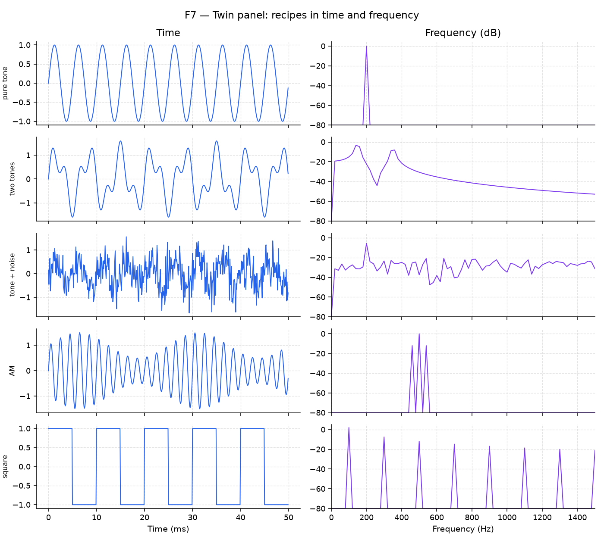
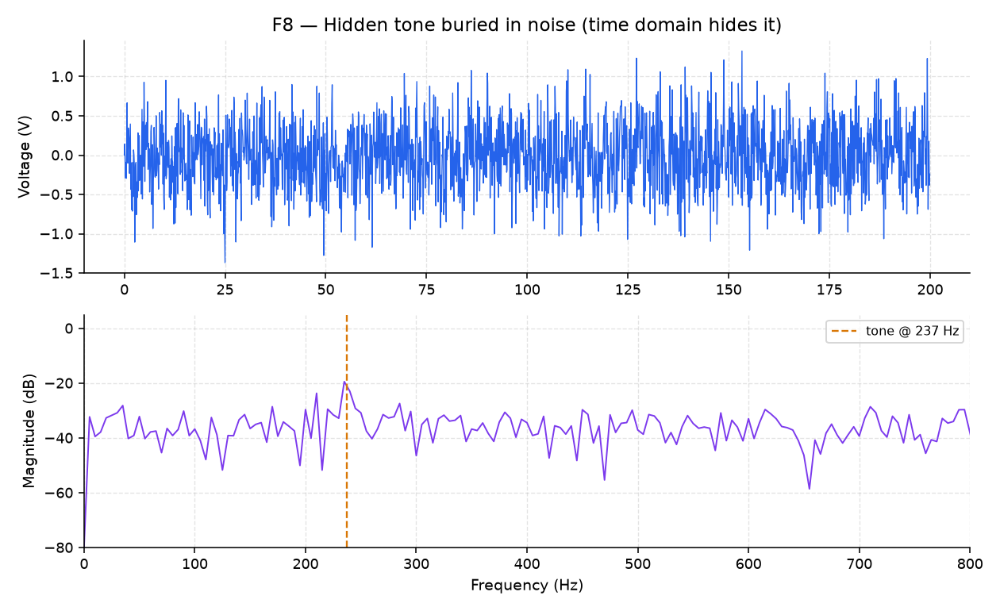
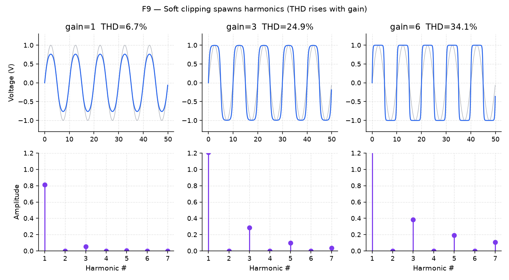
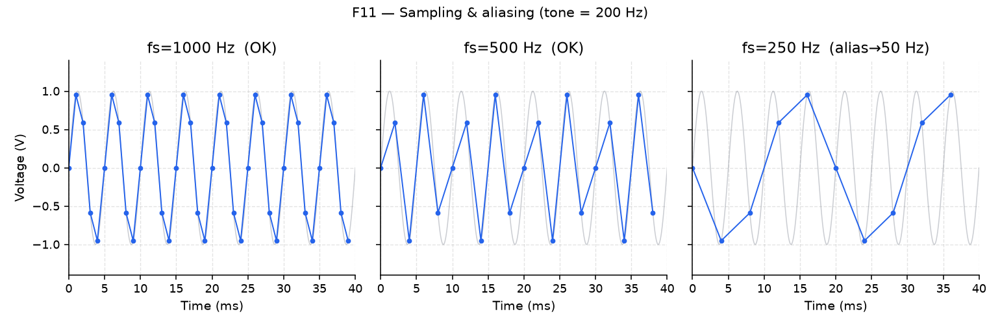
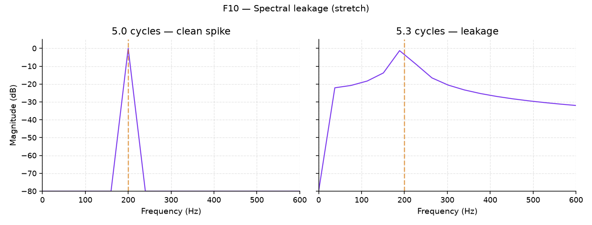

# Lab 03: Spectrum detective

You'll compute your first FFT, match test signals to their spectra, find a tone hidden under noise and confirm it with a checker, watch clipping create harmonics and read the THD, and make a tone lie about its frequency by sampling it too slowly. Before the scripts run, you'll predict a dB gap, a THD and an alias frequency.

Lab package: [`labs/lab-03-spectrum-detective/`](https://github.com/uoftasic/ad101/tree/main/labs/lab-03-spectrum-detective)

## Before you start

- Finish [Lab 02](labs/lab-02-harmonic-builder-overview.md).
- Read Movement III: [The FFT as an equalizer](guide/the-fft-as-an-equalizer.md), [Finding a quiet note](guide/finding-a-quiet-note.md), [Distortion and THD](guide/distortion-and-thd.md) and [Sampling fast enough](guide/sampling-fast-enough.md).
- Know the dB table in [Reading plots](reference/reading-plots.md).
- In a terminal in the noVNC desktop, go to the lab folder:

  ```bash
  . /foss/designs/common/.designinit
  mod ad101
  cd labs/lab-03-spectrum-detective
  ```

Time: about 1.5 hours, not counting the optional Part 5.

As before, most parts pair an explorer (`python3 src/explore.py --figure <id>`) with a snippet you save as a new `.py` file in this folder and run with `python3 <file>.py`.

## Part 1: Your first FFT (F7)

How does the same signal look in time and in frequency?

1. Save this as `first_fft.py`, but don't run it yet. It builds a two-note chord, A4 and E5, and plots it in time and in frequency:

   ```python
   import numpy as np
   import matplotlib.pyplot as plt

   fs = 10_000
   t = np.arange(0, 0.2, 1 / fs)          # a longer window gives a sharper spectrum

   # a two-note chord: A4 and E5
   v = np.sin(2 * np.pi * 440 * t) + 0.5 * np.sin(2 * np.pi * 659 * t)

   spectrum = np.abs(np.fft.rfft(v - v.mean()))
   freqs = np.fft.rfftfreq(len(v), d=1 / fs)
   spectrum_db = 20 * np.log10(np.maximum(spectrum, 1e-6))

   fig, axes = plt.subplots(2, 1, figsize=(7, 6))
   axes[0].plot(t * 1e3, v)
   axes[0].set_xlabel("Time (ms)")
   axes[0].set_ylabel("Voltage (V)")
   axes[0].set_title("time domain")

   axes[1].plot(freqs, spectrum_db)
   axes[1].set_xlim(0, 1000)
   axes[1].set_xlabel("Frequency (Hz)")
   axes[1].set_ylabel("Magnitude (dB)")
   axes[1].set_title("frequency domain")
   plt.tight_layout()
   plt.show()
   ```

   `v - v.mean()` removes any DC offset before the FFT, and `np.maximum(..., 1e-6)` keeps `log10` away from zero.

   E5 has half A4's amplitude. Before you run it, use the dB table in [Reading plots](reference/reading-plots.md) to predict how many dB below the A4 peak the E5 peak will sit, and write it down. Then run it.

   You should see a tangle of two overlapping wiggles in the top plot, and two clear peaks in the bottom one, at 440 Hz and near 659 Hz, at 60.0 dB and 53.4 dB in the course image. The dB values are raw FFT magnitudes, so the peaks sit far above 0 dB and only the gap between them means anything. Close the window.

   <details>
   <summary>Answer</summary>

   A ratio of ×0.5 is about −6 dB, so E5 should sit about 6 dB below A4. The plot shows 60.0 − 53.4 = 6.6 dB. The extra 0.6 dB is leakage, from [Finding a quiet note](guide/finding-a-quiet-note.md) (the optional Part 5 shows it on F10): in the 0.2 s window, 440 Hz fits a whole number of cycles (88) and 659 Hz doesn't (131.8). Change `659` to `660` in the script and the gap comes out at 6.0 dB.

   </details>

2. Open the twin-panel explorer:

   ```bash
   python3 src/explore.py --figure f7
   ```

   

3. Click through the signals on the left: pure tone, two tones, tone + noise, AM and square. AM (amplitude modulation) is a 500 Hz tone, the carrier, whose loudness wobbles at 40 Hz. Then switch the "dB scale" and "log freq" boxes on and off.

   You should see one spike for the pure tone, two spikes for two tones, a carrier with a sideband on each side for AM, and a comb of odd harmonics for the square. With dB on, small peaks show up that the linear axis hides. Close the window.

## Part 2: Find the hidden tone (F8)

Can you find a tone you can't see in the time plot?

1. Open the hidden-tone hunt:

   ```bash
   python3 src/explore.py --figure f8
   ```

   

2. Raise "Noise amp" until the time plot (top) is garbage. Then look for a narrow peak above the noise floor in the spectrum (bottom), and write down its frequency. To read it precisely, hover over the peak: the window's toolbar shows the cursor's x and y coordinates. Lowering the noise again makes both views clearer.

3. Close the window and check your answer, putting your frequency in place of `<Hz>`:

   ```bash
   python3 src/check.py --guess <Hz>
   ```

   You should see a line starting `Correct! Hidden tone is`. If you see `Not quite`, the message says how far off you were. Read the spike again: the checker accepts anything within 5 Hz.

4. Save this as `hidden_tone.py` and run it. It hides the same tone as F8 under different noise and reads the peak's frequency off the data with `np.argmax` instead of by eye. The code names the tone's frequency, so do steps 1–3 first:

   ```python
   import numpy as np
   import matplotlib.pyplot as plt

   fs = 10_000
   t = np.arange(0, 0.5, 1 / fs)

   rng = np.random.default_rng(0)
   hidden_freq = 237.0                          # you're not allowed to peek at this in real life —
                                                 # here it's revealed so you can check your answer
   noisy = 0.05 * np.sin(2 * np.pi * hidden_freq * t) + 0.3 * rng.standard_normal(len(t))

   spectrum = np.abs(np.fft.rfft(noisy - noisy.mean()))
   freqs = np.fft.rfftfreq(len(noisy), d=1 / fs)

   plt.subplot(2, 1, 1)
   plt.plot(t[:200] * 1e3, noisy[:200])
   plt.title("time domain — can you see the tone?")
   plt.xlabel("Time (ms)")

   plt.subplot(2, 1, 2)
   plt.plot(freqs, spectrum)
   plt.xlim(0, 500)
   plt.title("frequency domain — now can you?")
   plt.xlabel("Frequency (Hz)")
   plt.tight_layout()
   plt.show()

   guess = freqs[np.argmax(spectrum)]
   print(f"Loudest peak sits at ≈ {guess:.0f} Hz")
   ```

You should see pure noise in the time plot and one obvious spike in the spectrum. After you close the window, the script prints `Loudest peak sits at ≈ 236 Hz`, within 5 Hz of the hidden 237 Hz.

## Part 3: Distortion and THD (F9)

How much new energy does clipping put into the harmonics?

1. Open the distortion explorer:

   ```bash
   python3 src/explore.py --figure f9
   ```

   

2. Raise "Gain (into tanh)" and watch the waveform, the harmonic stems and the THD readout. $\tanh$ is the smooth clipping curve from [Distortion and THD](guide/distortion-and-thd.md); more gain drives the sine harder into it.

   You should see soft clipping flatten the peaks, the odd harmonics grow, and THD climb: about 2% at the lowest gain (0.5) and about 35% at gain 6. Set the gain to 1 and write down the THD it reads. Close the window.

3. Save this as `clip_thd.py`, but don't run it yet. It clips a sine at three gains, 1, 3 and 8, and measures THD from the spectrum:

   ```python
   import numpy as np
   import matplotlib.pyplot as plt

   fs = 10_000
   t = np.arange(0, 0.1, 1 / fs)
   f0 = 200.0
   clean = np.sin(2 * np.pi * f0 * t)

   for gain in (1.0, 3.0, 8.0):
       distorted = np.tanh(gain * clean)              # soft clip — bigger gain = harder clip

       spectrum = np.abs(np.fft.rfft(distorted - distorted.mean()))
       freqs = np.fft.rfftfreq(len(distorted), d=1 / fs)

       def amp_at(f_hz):
           return spectrum[np.argmin(np.abs(freqs - f_hz))]

       a1 = amp_at(f0)
       harmonics_power = sum(amp_at(f0 * n) ** 2 for n in (2, 3, 4, 5))
       thd = (harmonics_power ** 0.5) / a1

       print(f"gain={gain:>4.1f}   THD = {thd*100:5.1f}%")
   ```

   Before you run it, predict the THD it will print at gain 1 from your F9 reading, and whether gain 3 and gain 8 will print more or less. Write it down, then run it.

   You should see:

   ```text
   gain= 1.0   THD =   6.7%
   gain= 3.0   THD =  24.9%
   gain= 8.0   THD =  36.0%
   ```

   F9 at gain 1 reads `THD = 6.7%`, the same as the script. The script sums harmonics 2 to 5 and F9 sums harmonics 2 to 7, so the two can differ slightly at high gain.

## Part 4: Sampling and aliasing (F11)

How slowly can you sample a tone before it shows up at the wrong frequency, and which frequency does it show up at?

1. Open the aliasing explorer:

   ```bash
   python3 src/explore.py --figure f11
   ```

   

   The tone is 200 Hz and the sample rate starts at 1000 Hz. The box at the bottom ends in `OK (fs > 2f)`. Its `Nyquist` value is half the sample rate.

2. Before you move anything, work out the sample rate below which a 200 Hz tone aliases, and write it down.

3. Drag "Sample rate (Hz)" down slowly until the box changes, then set it to 250 Hz.

   You should see the box switch to `ALIASED → appears as … Hz` once the sample rate drops below 400 Hz, a bogus slow sine appear over the samples, and the spectrum peak fold below Nyquist. At 250 Hz the box reads `ALIASED → appears as 50 Hz`. Close the window.

4. Save this as `aliasing.py`, but don't run it yet. It samples a 900 Hz tone twice, once above Nyquist and once below:

   ```python
   import numpy as np
   import matplotlib.pyplot as plt

   true_freq = 900.0                 # Hz — the real tone
   duration = 0.02

   for fs in (5000.0, 1000.0):       # first well above Nyquist, then below it
       t = np.arange(0, duration, 1 / fs)
       v = np.sin(2 * np.pi * true_freq * t)

       nyquist_ok = fs > 2 * true_freq
       label = "OK — above Nyquist" if nyquist_ok else "ALIASED — below Nyquist"
       plt.plot(t * 1e3, v, marker="o", label=f"fs={fs:.0f} Hz  ({label})")

   plt.xlabel("Time (ms)")
   plt.ylabel("Voltage (V)")
   plt.legend(fontsize=8)
   plt.title(f"true tone = {true_freq:.0f} Hz")
   plt.show()
   ```

   At 250 Hz, F11 showed the 200 Hz tone as 50 Hz, which is 250 − 200. A tone between half the sample rate and the sample rate shows up at the sample rate minus the tone. Use that to predict the frequency the `fs=1000` points will appear to have, and write it down. Then run the script.

You should see the `fs=5000` points trace a recognizable 900 Hz wiggle, while the `fs=1000` points join into a slow, wrong-looking wave with a period of about 10 ms (100 Hz, which is 1000 − 900), like the backwards-spinning wheel in [Sampling fast enough](guide/sampling-fast-enough.md).

## Part 5 (optional): Spectral leakage (F10)

What happens to a peak when the window doesn't hold a whole number of cycles, and what does a Hann window do about it? Nothing in Parts 1 to 4 depends on this part, and it isn't in the time estimate.

1. Open the leakage explorer:

   ```bash
   python3 src/explore.py --figure f10
   ```

   

2. Set "Cycles in window" to 5.0, then to 5.3.

   You should see a clean spike at 5.0 (the label reads `clean spike (integer cycles)`) and a smeared peak at 5.3 (`smeared peak (leakage!)`).

3. Leave it at 5.3 and tick "Hann window".

   You should see the skirts (the smeared energy on either side of the peak) drop. Close the window.

   Why do spectra measured on a real bench look soft instead of like textbook sticks?

   <details>
   <summary>Answer</summary>

   Leakage. A real measurement window doesn't hold a whole number of cycles of every tone in the signal, so the peaks smear sideways into their neighbouring frequency bins, as at 5.3 cycles here. A window function such as Hann tapers the start and end of the recorded segment toward zero and reduces the smear.

   </details>

## Finishing

You're done when `python3 src/check.py --guess <Hz>`, with the frequency you read off F8 yourself, prints `Correct!` (Part 2, step 3), and your predictions from Parts 1, 3 and 4 are written down next to what the scripts printed.

### Questions

1. Why is the E5 peak 6.6 dB below A4 and not 6.0 dB? (Answered in Part 1, step 1.)
2. Below what sample rate does a 200 Hz tone alias? (Answered in Part 4, steps 2 and 3.)

### Submit

Nothing to submit.

Next on the [Course path](README.md#course-path): read Movement IV, [Filters are tone knobs](guide/filters-are-tone-knobs.md), [Reading a Bode plot](guide/reading-a-bode-plot.md), [Filtering a beat](guide/filtering-a-beat.md) and [More filter shapes](guide/more-filter-shapes.md), then do [Lab 04: RC filter and Bode](labs/lab-04-rc-bode-overview.md).
