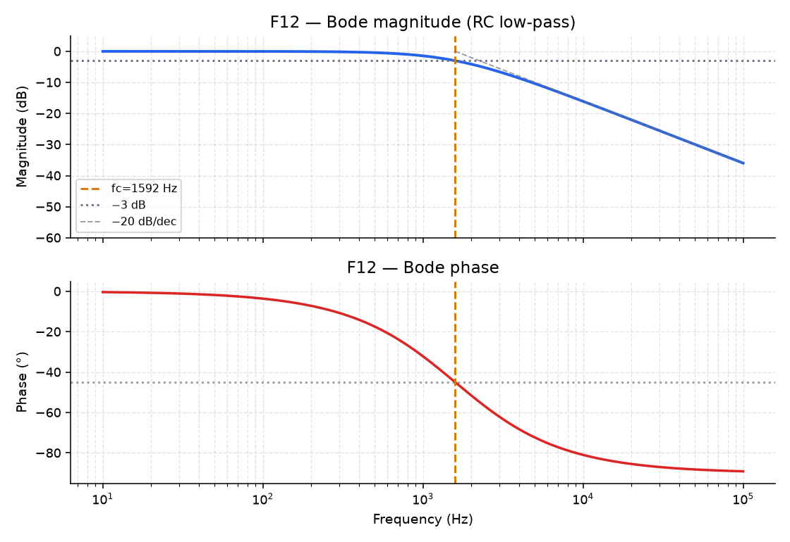
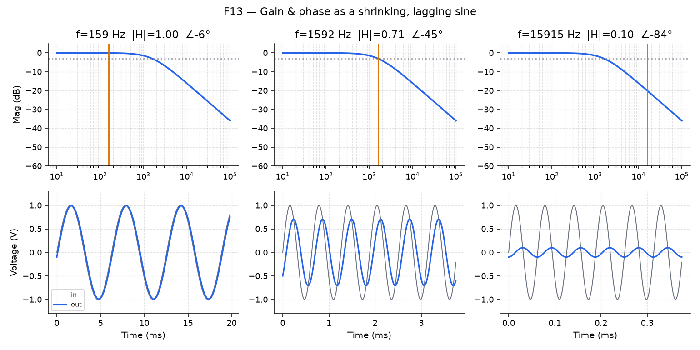
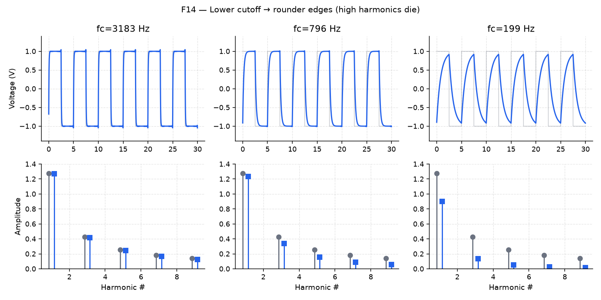
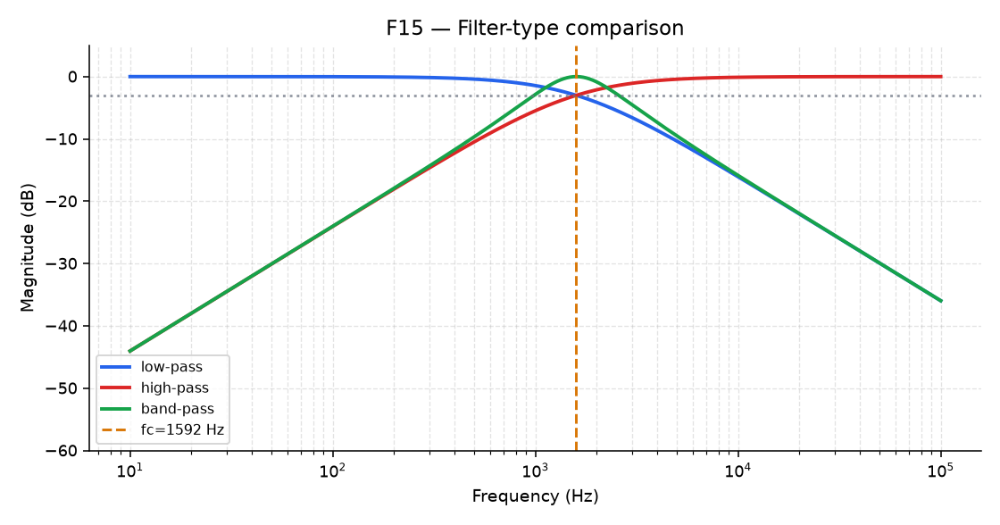

# Lab 04: RC filter and Bode

You'll sweep an RC low-pass on a live Bode plot, see what one point on that plot does to a sine (it comes out smaller and later than it went in), filter a square wave until its edges round off, and compare low-pass, high-pass and band-pass shapes. Each explorer has a matching snippet that computes the same thing from the formulas, and before you run each one you'll use the same formulas to work out what it should show.

Lab package: [`labs/lab-04-rc-bode/`](https://github.com/uoftasic/ad101/tree/main/labs/lab-04-rc-bode)

## Before you start

- Finish [Lab 03](../labs/lab-03-spectrum-detective-overview.md).
- Read Movement IV: [Filters are tone knobs](../guide/filters-are-tone-knobs.md), [Reading a Bode plot](../guide/reading-a-bode-plot.md), [Filtering a beat](../guide/filtering-a-beat.md) and [More filter shapes](../guide/more-filter-shapes.md).
- In a terminal in the noVNC desktop, go to the lab folder:

  ```bash
  . /foss/designs/common/.designinit
  mod ad101
  cd labs/lab-04-rc-bode
  ```

Time: about 1.5 hours.

The formulas you'll use throughout:

$$
f_c = \frac{1}{2\pi R C}
\qquad
\lvert H(f)\rvert = \frac{1}{\sqrt{1+(f/f_c)^2}}
\qquad
\angle H(f) = -\arctan(f/f_c)
$$

As before, each part pairs an explorer (`python3 src/explore.py --figure <id>`) with a snippet you save as a new `.py` file in this folder and run with `python3 <file>.py`.

## Part 1: The Bode explorer (F12)

What sets an RC low-pass's cutoff, and what do its magnitude and phase do there?

1. Open the Bode explorer:

   ```bash
   python3 src/explore.py --figure f12
   ```

   

   It opens with R = 1000 Ω and C = 100 nF, and the box at the bottom starts with `fc = 1592 Hz`.

2. Check that number against $f_c = 1/(2\pi RC)$ by hand, and write down your result.

3. Look at where the magnitude curve crosses the dotted −3 dB line, and at the phase curve below it.

   You should see the magnitude cross −3 dB at the dashed $f_c$ marker, the phase pass −45° there, and the dashed asymptote fall at −20 dB/decade past $f_c$.

4. Move R and C and watch $f_c$ follow $1/(2\pi RC)$. Next you'll set R = 2000 Ω and C = 50 nF (double R, halve C). Predict the new $f_c$ first and write it down, then set them.

   You should see the box start with `fc = 1592 Hz` again. Close the window.

   Why didn't $f_c$ move?

   <details>
   <summary>Answer</summary>

   Only the product $RC$ appears in $f_c = 1/(2\pi RC)$, and 2000 Ω × 50 nF is the same product as 1000 Ω × 100 nF, so the cutoff stays put. If you double R without halving C, the box reads `fc = 796 Hz`.

   </details>

5. Save this as `bode.py` and run it. It draws a Bode plot from the two formulas alone:

   ```python
   import numpy as np
   import matplotlib.pyplot as plt

   R, C = 1_000.0, 100e-9              # 1 kΩ, 100 nF
   fc = 1 / (2 * np.pi * R * C)
   print(f"cutoff fc ≈ {fc:.0f} Hz")

   f = np.logspace(1, 5, 400)          # 10 Hz to 100 kHz, log-spaced
   mag = 1 / np.sqrt(1 + (f / fc) ** 2)
   mag_db = 20 * np.log10(mag)
   phase_deg = -np.rad2deg(np.arctan(f / fc))

   fig, (ax1, ax2) = plt.subplots(2, 1, sharex=True, figsize=(7, 5))
   ax1.semilogx(f, mag_db)
   ax1.axvline(fc, color="orange", linestyle="--")
   ax1.axhline(-3, color="gray", linestyle=":")
   ax1.set_ylabel("Magnitude (dB)")

   ax2.semilogx(f, phase_deg)
   ax2.axvline(fc, color="orange", linestyle="--")
   ax2.axhline(-45, color="gray", linestyle=":")
   ax2.set_ylabel("Phase (°)")
   ax2.set_xlabel("Frequency (Hz)")
   plt.tight_layout()
   plt.show()
   ```

   You should see `cutoff fc ≈ 1592 Hz` printed, and a two-panel Bode plot where the magnitude crosses the dotted −3 dB line and the phase crosses the dotted −45° line, both at the orange dashed $f_c$ line.

6. Pick your own values of `R` and `C`. Write down the cutoff you expect from $f_c = 1/(2\pi RC)$, then change the two values in the script and re-run. Keep your numbers for Finishing.

   You should see the printed cutoff match your prediction, with the −3 dB crossing still on the orange line.

## Part 2: One Bode point in time (F13)

What does one point on the Bode curve do to a sine that goes through the filter?

1. Open the marker explorer:

   ```bash
   python3 src/explore.py --figure f13
   ```

   

   The left panel is the Bode magnitude for R = 1 kΩ, C = 100 nF. The right panel shows the input and output sines at the marker's frequency. The marker starts as close to $f_c$ as the slider's 0.02 steps allow, so the slider reads 3.2 and the box reads `f = 1585 Hz   |H| = 0.709 (-3.0 dB)   phase = -45°`.

2. With the marker at $f_c$, compare the two sines.

   You should see the output at about 0.707× the input, lagging by about 45° (an eighth of a cycle).

3. Before you move the slider, use the formulas at the top of this page to predict $\lvert H\rvert$ and the phase a decade below $f_c$ ($f = f_c/10$) and a decade above ($f = 10 f_c$). Write the four numbers down. Then move the slider, which sets `log10(f)`: moving it down by 1, to 2.2, puts the marker a decade below $f_c$, and moving it up to 4.2 puts it a decade above.

   You should see the output almost identical to the input a decade below ($\lvert H\rvert \approx 0.995$, phase about −6°), and tiny with nearly −90° of lag a decade above ($\lvert H\rvert \approx 0.100$, −20 dB, phase about −84°). Close the window.

4. Save this as `bode_point.py` and run it. At each of three frequencies it makes an input sine and draws the output that the Bode formulas predict for it:

   ```python
   import numpy as np
   import matplotlib.pyplot as plt

   R, C = 1_000.0, 100e-9
   fc = 1 / (2 * np.pi * R * C)

   fs = 200_000.0
   t = np.arange(0, 0.02, 1 / fs)

   for test_freq, label in [(fc / 10, "a decade below fc"), (fc, "at fc"), (fc * 10, "a decade above fc")]:
       drive = np.sin(2 * np.pi * test_freq * t)
       mag = 1 / np.sqrt(1 + (test_freq / fc) ** 2)
       phase_rad = -np.arctan(test_freq / fc)
       output = mag * np.sin(2 * np.pi * test_freq * t + phase_rad)

       plt.figure(figsize=(6, 2.5))
       plt.plot(t * 1e3, drive, label="input", alpha=0.6)
       plt.plot(t * 1e3, output, label="output", linewidth=2)
       plt.title(f"{label}: gain={mag:.3f}, phase={np.rad2deg(phase_rad):.1f}°")
       plt.xlabel("Time (ms)")
       plt.legend(fontsize=8)
       plt.xlim(0, 3 / test_freq * 1e3)
       plt.tight_layout()
       plt.show()
   ```

   The three plots open one at a time; close each to see the next. You should see the same three points on the Bode curve that F13 showed you, drawn as time plots and titled `a decade below fc: gain=0.995, phase=-5.7°`, `at fc: gain=0.707, phase=-45.0°` and `a decade above fc: gain=0.100, phase=-84.3°`. Compare them with your predictions from step 3.

## Part 3: A square wave through the RC (F14)

What does a low-pass do to a square wave, and which harmonics go first?

1. Open the square-wave explorer:

   ```bash
   python3 src/explore.py --figure f14
   ```

   

   A 200 Hz square wave goes through an RC low-pass with R = 1 kΩ and C = 200 nF. The box reads `fc = 796 Hz`. The stem plot on the right compares harmonics 1, 3, 5, 7 and 9 of the input (gray) and the output.

2. Raise C, which lowers $f_c$, and compare input and output on both panels.

   You should see the edges round off, and the output stems for the high odd harmonics (5, 7, 9) shrink first. Close the window.

3. Save this as `filter_square.py`, but don't run it yet. It filters a 500 Hz square wave by scaling its spectrum by $H(f)$ and transforming back, for three values of C:

   ```python
   import numpy as np
   import matplotlib.pyplot as plt

   fs = 50_000.0
   t = np.arange(0, 0.01, 1 / fs)
   f0 = 500.0
   square = np.sign(np.sin(2 * np.pi * f0 * t))

   def rc_lowpass_filter(x, fs, R, C):
       """Apply an RC low-pass by scaling the spectrum, then transforming back."""
       n = len(x)
       freqs = np.fft.rfftfreq(n, d=1 / fs)
       fc = 1 / (2 * np.pi * R * C)
       mag = 1 / np.sqrt(1 + (freqs / fc) ** 2)
       phase = -np.arctan(freqs / fc)
       H = mag * np.exp(1j * phase)
       X = np.fft.rfft(x)
       return np.fft.irfft(X * H, n=n)

   for C in (10e-9, 100e-9, 1e-6):          # progressively lower cutoff
       filtered = rc_lowpass_filter(square, fs, R=1_000.0, C=C)
       fc = 1 / (2 * np.pi * 1_000.0 * C)
       plt.plot(t * 1e3, filtered, label=f"C={C*1e9:.0f} nF (fc≈{fc:.0f} Hz)")

   plt.plot(t * 1e3, square, color="gray", linestyle="--", label="input square", alpha=0.5)
   plt.xlabel("Time (ms)")
   plt.ylabel("Voltage (V)")
   plt.legend(fontsize=8)
   plt.show()
   ```

   Before you run it, work out $f_c$ for each of the three capacitors with R = 1 kΩ, and write them down. Then run it.

   You should see three filtered versions of the dashed input square, labelled `C=10 nF (fc≈15915 Hz)`, `C=100 nF (fc≈1592 Hz)` and `C=1000 nF (fc≈159 Hz)`. The edges get softer with each step up in C, from nearly square at 10 nF to a small, rounded wave at 1000 nF.

   Why do the edges soften as C goes up?

   <details>
   <summary>Answer</summary>

   Raising C lowers $f_c$. A square wave is a pile of odd harmonics, and it's the high ones that make its edges sharp, so the lower $f_c$ goes, the more of those high harmonics the filter turns down and the rounder the edges get. [Filtering a beat](../guide/filtering-a-beat.md) has the same picture.

   </details>

## Part 4: Three filter shapes (F15)

How do low-pass, high-pass and band-pass shapes differ around the same $f_c$?

1. Open the filter-type comparison:

   ```bash
   python3 src/explore.py --figure f15
   ```

   

2. Look at the low-pass, high-pass and band-pass curves together, then move R and C to shift $f_c$.

   You should see three different pass/stop patterns around the same $f_c$, all moving together when $f_c$ moves. Close the window.

3. Save this as `filter_shapes.py`, but don't run it yet. It computes all three curves from the same `fc`:

   ```python
   import numpy as np
   import matplotlib.pyplot as plt

   R, C = 1_000.0, 100e-9
   fc = 1 / (2 * np.pi * R * C)
   f = np.logspace(1, 5, 400)
   u = f / fc

   lowpass = 1 / np.sqrt(1 + u**2)
   highpass = u / np.sqrt(1 + u**2)
   Q = 2.0
   bandpass = (u / Q) / np.sqrt((1 - u**2) ** 2 + (u / Q) ** 2)

   plt.semilogx(f, 20 * np.log10(lowpass), label="low-pass")
   plt.semilogx(f, 20 * np.log10(highpass), label="high-pass")
   plt.semilogx(f, 20 * np.log10(bandpass), label="band-pass")
   plt.axvline(fc, color="gray", linestyle="--", label="fc")
   plt.ylim(-40, 5)
   plt.xlabel("Frequency (Hz)")
   plt.ylabel("Magnitude (dB)")
   plt.legend()
   plt.show()
   ```

   At $f = f_c$, `u` is 1. Before you run it, put $u = 1$ into the `lowpass` and `highpass` lines and work out both values in dB. Then run it.

   You should see the three curves meet the dashed `fc` line from different sides: the low-pass keeps what's below it, the high-pass keeps what's above it, and the band-pass peaks there. The low-pass and high-pass curves both pass through −3 dB at the dashed line.

## Finishing

You're done when `bode.py`, run with an R and C you chose, prints the cutoff you predicted (Part 1, step 6), and your four predictions for the decade points match F13 and the `bode_point.py` titles (Part 2, steps 3 and 4).

### Questions

1. Why does doubling R and halving C leave $f_c$ where it was? (Answered in Part 1, step 4.)
2. Why does raising C round off a square wave's edges? (Answered in Part 3, step 3.)

### Submit

Nothing to submit.

Next on the [Course path](../index.md#course-path): do [Lab 05: Signal workshop](../labs/lab-05-signal-workshop-overview.md), where you write a script that synthesizes, analyzes and filters a signal on its own.
